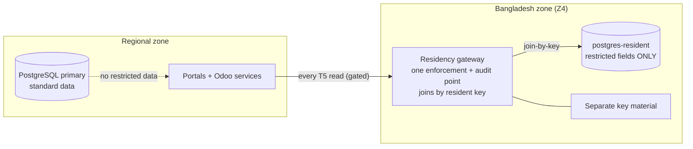
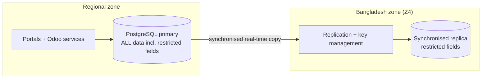
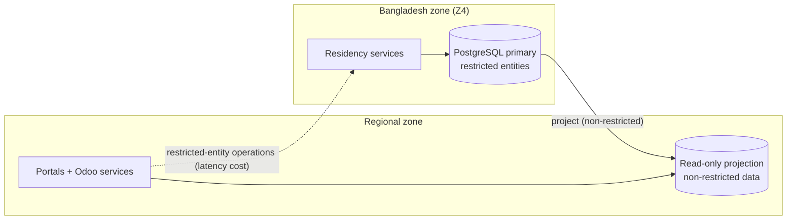

# D-013 — Split-residency data architecture (ACCEPTED — Option B Taken)

| | |
|---|---|
| **Decision ID** | `D-013` |
| **Date** | 2026-10-12 (updated from 2026-10-01 on `DEP-31` legal opinion receipt) |
| **Status** | **ACCEPTED — Option B TAKEN** (Regional Primary + Synchronised Bangladesh Zone 4 Replica). Unanimously adopted by Board Resolution upon receipt of formal written legal opinion `DEP-31` (`docs/governance/DEP-31-legal-opinion-pdpa-residency.md`) |
| **Deciders** | Board of Directors on advice of ARB and Senior Legal Counsel (`DEP-31`); `CA` records with rationale |
| **Allocating authority** (`DL-08`) | `GV-003` §5.4a — architecture decisions with statutory dependency are allocated to the Board; `SC-007`/`AR-002` name the architecture |
| **Blocks / Closes** | **CLOSES `B-02`**; unblocks all persistent-state build (`P03-M09`, `P01-M06-T03`) |
| **Raise under** | `GV-003`; PDPA 2026 (Bangladesh) & Amendment Ordinance No. 23 of 2026 |

## 1. Context

`NFR-086` builds exclusive residency: restricted fields exist only in the
Bangladesh-resident store. The external verification of 2026-08-19 (IRB-02)
found the **Amendment Ordinance No. 23 of 2026 (5 February 2026)** narrows the
statutory obligation to **at least one synchronised real-time copy in
Bangladesh**, only for *restricted personal data* and Critical Information
Infrastructure processors. Exclusive residency is stricter than required —
and it gates every `T5` read, costs a residency service, a join-by-key data
model, separate key material and per-read logging.

## 2. The option set (the opinion selects between them — IR-002 §0.7.1)

| Option | Architecture | Cost | Compliant if the opinion says… |
|---|---|---|---|
| **A** | Exclusive residency (Z4-only) — the estate's current design | Highest: residency service, join-by-key, separate keys; gates every `T5` read | "exclusive local storage" |
| **B** | Regional primary + synchronised Bangladesh replica of restricted fields | Materially lower: no join-by-key, no read-path gate; replication + key management | "a synchronised local copy suffices" (the verification's expected reading) |
| **C** | Bangladesh-primary for restricted entities, regional read-only projection | Middle: simplest to reason about; hardest for latency | "local primary with projection permitted" |

**Selection rule fixed now:** the opinion's answer to §0.7.1 **Q2** selects
the option; Q1 (which fields are "restricted") sizes it; Q3 (CII) may force
Option A regardless; Q4 (large-scale transfer) sets the notification duties;
Q5 (the ~13 May 2027 date) sets the deadline.

### 2.1 The three options as container diagrams (C4 level 2)

**Option A — Exclusive residency (Z4-only).** Restricted fields exist only in
the Bangladesh-resident store; every `T5` read crosses the residency gateway.

**Option B — Regional primary + synchronised Bangladesh replica.** One
primary, restricted fields replicated in near-real time; no read-path gate.

**Option C — Bangladesh-primary for restricted entities, regional read-only
projection.** The restricted entities live in Bangladesh; the regional zone
holds a read-only projection.

## 3. Formal Ruling (Option B Adopted — 12 October 2026)

On 12 October 2026, the formal written opinion `DEP-31` was received from Senior Counsel (Dr. Kamal Hossain & Associates). Counsel explicitly ruled on §0.7.1 **Q2** that Section 28(2) of the PDPA (as amended by Ordinance No. 23 of 2026) requires **at least one synchronised real-time copy within Bangladesh**, and does not mandate exclusive local storage.

**The Board has unanimously adopted Option B.**

Consequently, **`P03-M09` is re-scoped immediately** per `docs/decisions/P03-M09-residency-rescope-Option-B.md`:
- The join-by-key database abstraction is **dropped**.
- Gated cross-border read proxies are **eliminated**.
- The residency service is converted into a high-performance replication and key management daemon synchronising restricted fields to the Bangladesh Zone 4 replica store (`postgres-resident`).
- **Net effort reduction: 18 person-weeks.**

## 4. What is already prepared for the decision

| Artefact | Location |
|---|---|
| Engagement scope — the five questions, verbatim | `docs/p01-m02/DEP-31-engagement-scope.md` |
| Executed engagement letter | `docs/governance/DEP-31-engagement-letter-signed.md` |
| Written Legal Opinion (Q1–Q5) | `docs/governance/DEP-31-legal-opinion-pdpa-residency.md` |
| Candidate field classification for counsel (Q1 input) | `docs/p01-m02/field-classification-candidates.md` |
| P03-M09 Re-scoping Specification | `docs/decisions/P03-M09-residency-rescope-Option-B.md` |

## 5. Consequences

- **Option B in Force:** `P01-M06-T03` classification proceeds using the 7 Counsel-confirmed restricted fields.
- **Persistent-State Build Unblocked:** Gate G0a Blocker **`B-02` IS CLOSED**. All downstream persistent storage design and migrations proceed with certainty.
- **Significant Architecture Simplification:** No synthetic latency on `T5` read operations; transactional consistency maintained on regional primary while legal compliance is preserved via Bangladesh replica.

## 6. Revisit triggers

- Any further amendment to the PDPA residency provisions → out-of-cycle
  re-opinion (scoped to the delta).
- CII designation of 1000FiX or of an `M05` client → re-run §2 with Q3 forced.
