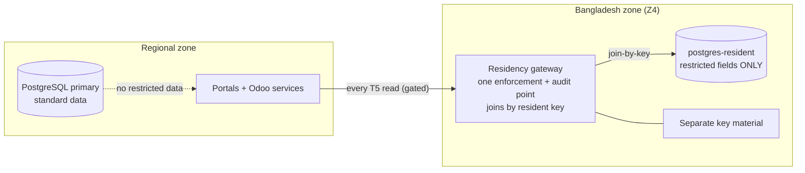
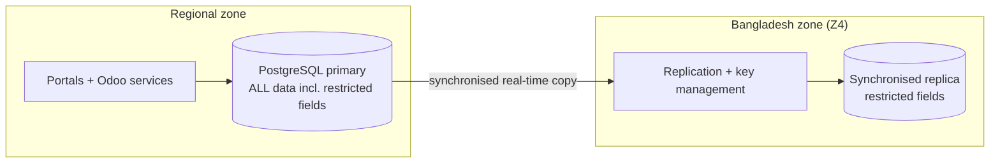
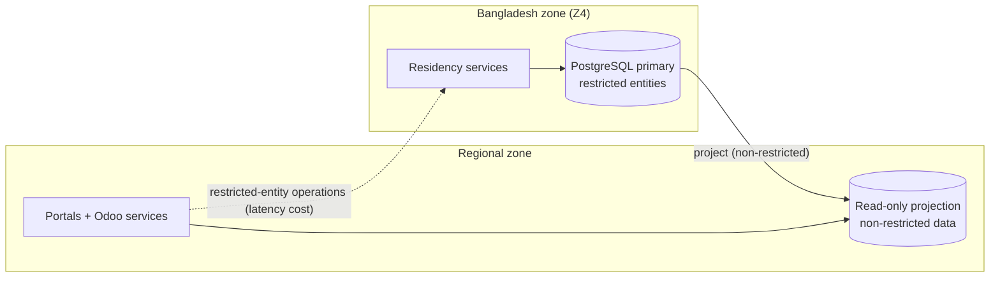

# D-013 — Split-residency data architecture (PREPARED — awaiting the DEP-31 opinion)

| | |
|---|---|
| **Decision ID** | `D-013` |
| **Date** | 2026-10-01 |
| **Status** | **PROPOSED / PREPARED** — cannot be taken until the `DEP-31` external legal opinion lands (6–10 week lead, commissioned `P01-M02-T01`). This record fixes the option set, the selection rule and the interim ruling so the decision takes **hours, not weeks, on receipt** |
| **Deciders** | Board on the `DEP-31` opinion; `CA` records with rationale and dissent |
| **Allocating authority** (`DL-08`) | `GV-003` §5.4a — architecture decisions with statutory dependency are allocated to the Board; `SC-007`/`AR-002` name the architecture |
| **Blocks** | **All persistent-state build** (`P03-M09`, `P01-M06-T03`). `B-02` — the longest single lead on the critical path |
| **Raise under** | `GV-003`; PDPA 2026 (Bangladesh) |

## 1. Context

`NFR-086` builds exclusive residency: restricted fields exist only in the
Bangladesh-resident store. The external verification of 2026-08-19 (IRB-02)
found the **Amendment Ordinance No. 23 of 2026 (5 February 2026)** narrows the
statutory obligation to **at least one synchronised real-time copy in
Bangladesh**, only for *restricted personal data* and Critical Information
Infrastructure processors. Exclusive residency is stricter than required —
and it gates every `T5` read, costs a residency service, a join-by-key data
model, separate key material and per-read logging.

## 2. The option set (the opinion selects between them — IR-002 §0.7.1)

| Option | Architecture | Cost | Compliant if the opinion says… |
|---|---|---|---|
| **A** | Exclusive residency (Z4-only) — the estate's current design | Highest: residency service, join-by-key, separate keys; gates every `T5` read | "exclusive local storage" |
| **B** | Regional primary + synchronised Bangladesh replica of restricted fields | Materially lower: no join-by-key, no read-path gate; replication + key management | "a synchronised local copy suffices" (the verification's expected reading) |
| **C** | Bangladesh-primary for restricted entities, regional read-only projection | Middle: simplest to reason about; hardest for latency | "local primary with projection permitted" |

**Selection rule fixed now:** the opinion's answer to §0.7.1 **Q2** selects
the option; Q1 (which fields are "restricted") sizes it; Q3 (CII) may force
Option A regardless; Q4 (large-scale transfer) sets the notification duties;
Q5 (the ~13 May 2027 date) sets the deadline.

### 2.1 The three options as container diagrams (C4 level 2)

**Option A — Exclusive residency (Z4-only).** Restricted fields exist only in
the Bangladesh-resident store; every `T5` read crosses the residency gateway.

**Option B — Regional primary + synchronised Bangladesh replica.** One
primary, restricted fields replicated in near-real time; no read-path gate.

**Option C — Bangladesh-primary for restricted entities, regional read-only
projection.** The restricted entities live in Bangladesh; the regional zone
holds a read-only projection.

## 3. Interim ruling (already in force per IR-002 §0.7.1)

**Until the opinion lands, `P03-M09` builds Option A** — it satisfies B and C
as well and is the only choice that cannot be wrong. **The moment the opinion
lands, re-scope** (this record's §2 table, no new analysis needed).

## 4. What is already prepared for the decision

| Artefact | Location |
|---|---|
| Engagement scope — the five questions, verbatim | `docs/p01-m02/DEP-31-engagement-scope.md` |
| Candidate field classification for counsel (Q1 input) | `docs/p01-m02/field-classification-candidates.md` |
| Option cost model | §2 above; `SC-007` carries the detail |

## 5. Consequences (on taking)

- If A: no re-scope; `NFR-086` stands as written.
- If B: `P01-M06-T03` classification proceeds against the counsel-confirmed
  restricted list; the residency service is descoped to replication + key
  management; **the join-by-key data model is dropped** — the single largest
  saving, and the reason the opinion is worth its 6–10 week lead.
- If C: latency engineering for the regional projection becomes a Wave-1
  performance workstream.

## 6. Revisit triggers

- Any further amendment to the PDPA residency provisions → out-of-cycle
  re-opinion (scoped to the delta).
- CII designation of 1000FiX or of an `M05` client → re-run §2 with Q3 forced.
