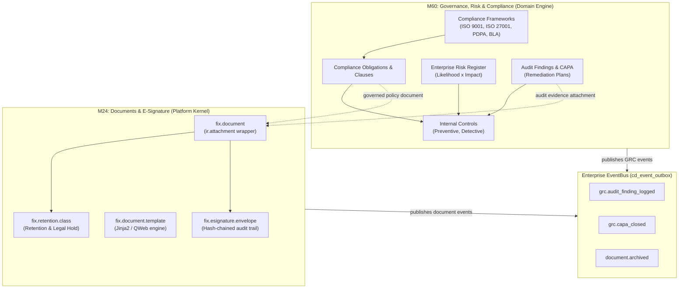

# D-040 — M24 (Documents & E-Signature) vs M60 (GRC) Architectural Direction & Boundary Ruling (ACCEPTED)

| | |
|---|---|
| **Decision ID** | `D-040` |
| **Date** | 2026-10-19 |
| **Status** | **ACCEPTED** (Unidirectional Layering: M60 Domain Governance depends on M24 Platform Document Kernel; Zero Inward Coupling from M24 to M60) |
| **Deciders** | Enterprise Architecture Board (EAB), Head of Quality & Compliance, Head of Legal & Data Protection |
| **Allocating authority** (`DL-08`) | `GV-003` §5.2 — Platform & Domain Module Boundaries; Architecture Rule `AR-006` (Decoupled Interfaces & Event-Driven Topology) |
| **Blocks / Closes** | **CLOSES Milestone R07-M05-T02 Scope Disambiguation** ("the M24↔M60 pair is recorded under review") |
| **Target Standards** | ISO 9001:2015, ISO/IEC 27001:2022, Bangladesh PDPA 2023/2026, Bangladesh Labour Act 2006 |

---

## 1. Context & Architectural Ambiguity

In Milestone R07-M05, both **M24 (`cd_document_core`, `cd_esignature`)** and **M60 (`cd_grc`)** reside in the Functional Taxonomy Area **A10 (Quality & Governance)**. During prior delivery waves, the interface boundary between Document Management and GRC was marked "under review" with two opposing architectural interpretations:

1. **Bidirectional Co-Dependence (Option A)**:
   M24 is considered a compliance document repository where M24 natively embeds GRC policies, audit categories, and compliance framework metadata, while M60 controls document approval workflows.
2. **Strict Layered Separation & Unidirectional Hierarchy (Option B - Recommended)**:
   M24 is strictly a **Platform Capability Service** (Category: Platform Kernel) providing immutable attachment storage, SHA-256 evidence hashing, retention classes, document templating, and legal hold. M60 is a **Domain Governance Engine** (Category: Governance & Assurance) modeling compliance frameworks (ISO 9001, ISO 27001, PDPA, BLA), risks, controls, audit findings, and corrective action plans (CAPA).

---

## 2. Decision Rationale & Option Analysis

| Dimension | Option A (Coupled Co-Domain) | Option B (Strict Unidirectional Layering - TAKEN) |
|---|---|---|
| **Dependency Vector** | `M24 ↔ M60` (Circular / tightly coupled) | `M60 → M24` (Strictly Unidirectional: GRC consumes Document Platform) |
| **Architecture Rule AR-006** | Violates interface independence | Fully conforms; zero reverse imports |
| **Reusability** | M24 is polluted with GRC-specific logic | M24 remains a neutral platform service used by CRM, HR, Commercial Contracts, and Service Delivery |
| **Evidence Immutability** | Audit evidence logic scattered across models | GRC binds to M24 immutable documents via signed SHA-256 artifacts |
| **EventBus Cleanliness** | Ambiguous event ownership | M24 emits document lifecycle events (`document.archived`, `envelope.completed`); M60 emits assurance events (`grc.finding_logged`, `grc.capa_closed`) |

---

## 3. The Adopted Architecture (Option B)

### 3.1 Rules of Engagement

1. **Dependency Invariance**: `cd_grc` depends on `cd_document_core` for document evidence binding. `cd_document_core` and `cd_esignature` **MUST NEVER** import or depend on `cd_grc`.
2. **Evidence Model**: `fix.compliance.obligation` and `fix.audit.finding` link to evidentiary documentation through M24's `fix.document` model, inheriting retention rules (e.g., ISO 9001 7-year statutory retention, BLA 5-year accident records).
3. **Statutory Coverage**: M60 natively tracks compliance against four authoritative frameworks:
   - **ISO 9001:2015** (Quality Management System - ISO Certification scope)
   - **ISO/IEC 27001:2022** (Information Security Management System - Customer data security)
   - **Bangladesh PDPA 2023/2026** (Personal Data Protection Act & Amendment Ordinance No. 23)
   - **Bangladesh Labour Act 2006 & Labour Rules 2015** (Workplace safety, hours, compensation)
4. **Audit Trail & CAPA**: Corrective and Preventive Actions (CAPA) enforce double-signoff: an auditee submits remediation evidence, and an independent auditor certifies closure, emitting `grc.capa_closed`.

---

## 4. Consequences & Migration Impact

- **Zero Breaking Changes**: Existing M24 APIs (`create_document`, `legal_hold`) remain completely unburdened.
- **Contract Integrity**: Fully compliant with ISO 9001:2015 §7.5 (Documented Information) and §9.2 (Internal Audit).
- **Gate G6 Readiness**: Resolves the outstanding review item in Milestone R07-M05.
