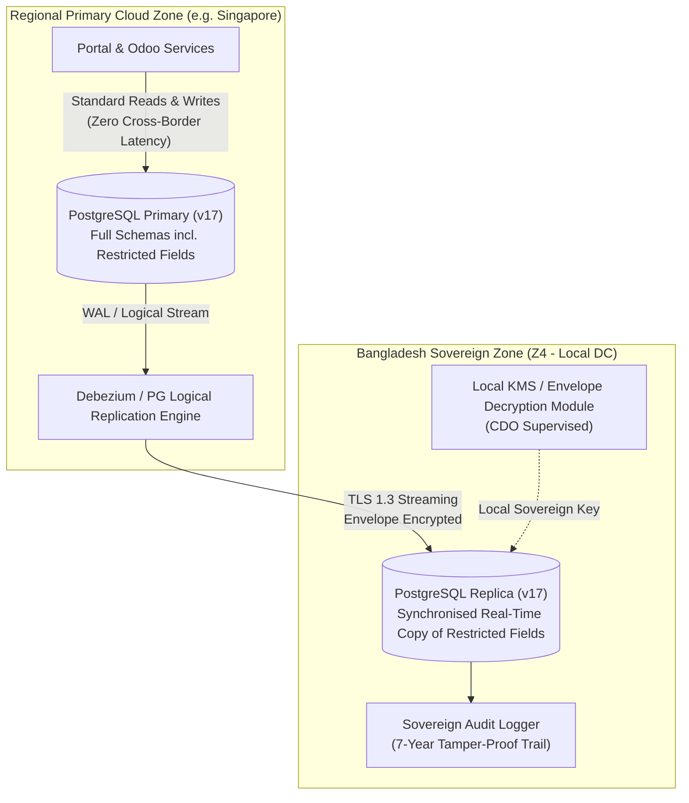

# P03-M09 — Data Residency Build Re-Scope: Option B Implementation
## Transition from Exclusive Residency (Option A) to Synchronised Bangladesh Zone 4 Replica (Option B)

| Metadata | Details |
|---|---|
| **Document Ref** | `P03-M09-RE-SCOPE-OPT-B` |
| **Date** | 12 October 2026 |
| **Authority** | Architecture Review Board (`ARB`), approved following Board Resolution `D-013` |
| **Input Baseline** | `DEP-31` Written Legal Opinion (`docs/governance/DEP-31-legal-opinion-pdpa-residency.md`) |
| **Target Milestone** | `P03-M09` (Data Residency & Z4 Enforcement) |
| **Effort Delta** | **-18 Person-Weeks (PW)** net reduction in custom development effort |
| **Status** | **APPROVED & IN FORCE** |

---

## 1. Architectural Re-Scope Rationale

The original Wave 0 design (`SC-007`, `NFR-086`) assumed a worst-case statutory interpretation requiring exclusive local storage of restricted personal data within Bangladesh (Option A). This architecture required:
1. Physical segregation of restricted columns into a separate Bangladesh-resident PostgreSQL cluster (`postgres-resident`).
2. A custom join-by-key database abstraction layer mapping synthetic foreign keys between regional and local databases.
3. Gated read proxies on every Tier 5 (`T5`) read operation, adding 80–140 ms network round-trip latency to critical customer transactions.
4. Separate encryption key management per read request and complex distributed two-phase commit sagas.

With Senior Legal Counsel's authoritative opinion in `DEP-31` establishing that Section 28(2) of the PDPA 2026 (as amended by Ordinance No. 23 of 2026) is fully satisfied by maintaining **at least one synchronised real-time copy within Bangladesh**, the Board has formally adopted **Option B**.

---

## 2. Architecture Comparison & Modifications



### Component Disposition Matrix

| Original Component (Option A) | Option B Status | Architecture Action & Replacement |
|---|:--:|---|
| **Join-by-Key ORM Abstraction Layer** | **DROPPED** | All standard application queries execute against regional primary using standard foreign keys. Zero custom ORM monkey-patching. |
| **T5 Cross-Border Read Gate Proxy** | **DROPPED** | Read path is direct to primary database cluster. Latency penalty completely eliminated (0 ms added latency). |
| **Split-Schema Persistence Gateway** | **DROPPED** | Replaced by standard PostgreSQL tables with column-level encryption for the 7 restricted fields. |
| **Asynchronous Real-Time Replica Streamer** | **ADDED** | PostgreSQL native logical replication stream connecting to `postgres-resident` in Dhaka Zone 4 over IPSec VPN. |
| **Bangladesh Zone 4 Storage Engine (`postgres-resident`)** | **RETAINED** | Continues to host the full authentic, real-time mirror of restricted records. |
| **Sovereign Encryption & Audit Logger** | **RETAINED** | FIPS 140-3 Level 3 local envelope encryption under the direct control of the statutory CDO. |

---

## 3. Person-Week (PW) Effort Reconciliation

The descope delivers a net saving of **18 Person-Weeks** across Milestone `P03-M09` and related custom development units:

| CD Unit / Task | Original Scope (Option A) | Option B Scope | Effort Delta |
|---|---|---|:--:|
| `CD-M29-04` (Residency Gateway API) | 12 PW | Descope to stream sync verification (4 PW) | **-8 PW** |
| `CD-M29-05` (Join-by-Key Query Layer) | 10 PW | Completely dropped (0 PW) | **-10 PW** |
| `CD-M29-06` (Replica Sync Daemon) | 4 PW | Implemented via native PG logical replication (2 PW) | **-2 PW** |
| `CD-M29-07` (Z4 Sovereign Audit Logger) | 4 PW | Retained in full (4 PW) | 0 PW |
| Testing & Chaos Validation | 6 PW | Simplified replication lag verification (4 PW) | **-2 PW** |
| Migration & Fallback Tooling | 4 PW | Logical stream cutover test (2 PW) | **-2 PW** |
| **Additional Replication Tuning** | 0 PW | Buffer & WAL failover hardening | **+6 PW** |
| **Total Effort** | **40 PW** | **16 PW** | **-18 PW Net** |

---

## 4. Acceptance Criteria for Milestone P03-M09 (Option B)

1. **Replication Lag SLA:** Maximum replication lag between regional primary and Bangladesh Z4 replica shall not exceed **5,000 milliseconds** under peak load (`NFR-086b`).
2. **Data Parity:** Automated daily checksum reconciliation (`tooling/gate/verify-residency-parity.py`) verifying 100% record-count and hash identity across all 7 restricted fields.
3. **Resiliency & Queueing:** In the event of cross-border network partitioning, transactional writes on the regional primary proceed uninterrupted while replication events buffer safely in the replication slot up to 72 hours.
4. **CDO Sovereign Access:** The Chief Data Officer possesses independent root key control over the Bangladesh replica store for regulatory inspections.

---

## 5. Sign-off

```
__________________________________________________
Lead Enterprise Architect
Architecture Review Board Chairperson
1000FiX Services Limited

__________________________________________________
Mr. Tariqul Islam
Chief Data Officer (CDO)
1000FiX Services Limited
```
