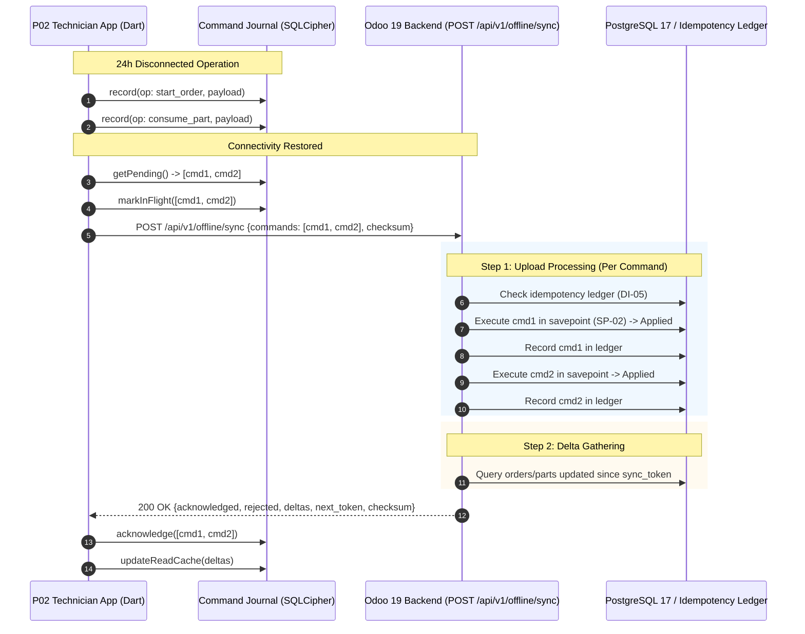

# 1000FiX Offline Synchronization Protocol Specification

**Document Code**: PROT-OFFLINE-SYNC-01  
**Architecture Reference**: AR-010, ADR-024, FL-03  
**Status**: APPROVED / IN PRODUCTION  
**Last Updated**: October 2026  

---

## 1. Executive Summary & Core Invariant

The 1000FiX Integrated Smart Platform operates in Bangladesh's challenging field environment where 2G/3G connectivity drops frequently, mobile data is intermittent, and rural/basement job sites have zero signal.

> **Fundamental Invariant (AR-010 §3)**:  
> **"Commands, Not Records."**  
> The client offline store (`fix_offline`) is an append-only command journal, NOT an offline mirror database. The local read cache is NEVER authoritative; it is merely a local projection of the last-known server state.

---

## 2. Invariants & Rules Catalog

| Rule Code | Rule Title | Specification |
|:---|:---|:---|
| **SP-01** | Append-Only Journal | Client mutations append an immutable command with client-generated UUIDv4. Commands are never updated in place except for lifecycle status (`pending`, `in_flight`, `acknowledged`, `rejected`). |
| **SP-02** | Isolated Server Transactions | The server processes batches command-by-command with individual database savepoints. One command's rejection MUST NEVER roll back other valid commands in the batch. |
| **SP-03** | Batch Checksum Integrity | Every upload batch includes a client-computed SHA-256 digest verified by the server before transaction dispatch. |
| **SP-07** | Upload-First Sequence | In any sync roundtrip, **upload MUST precede download**. Download-first causes newly recorded technician field actions to temporarily disappear from the UI, provoking duplicate manual inputs. |
| **SP-09** | Deferred Evidence Channel | High-bandwidth media uploads (photos, Bengali voice notes, signature bitmaps) are partitioned into an asynchronous chunked channel (`POST /api/v1/offline/evidence/chunk`). Media queues **NEVER block job status sync**. |
| **DI-05** | Idempotency Ledger | Server tracks every command UUID in `fix.offline.idempotency.ledger`. Replays and network retries return cached JSON results with zero side-effects. |
| **AR-010 §6**| Two-State Disclosure | The UI contract strictly distinguishes between `notYetSynced` (local edits awaiting upload) and `syncedAndRejected` (server rejections). These states **must NEVER be conflated**. |

---

## 3. The Synchronization Lifecycle (SP-07)

---

## 4. Conflict Authority Matrix

When concurrent edits occur or server state changes during technician offline periods:

| Operation | Server Condition | Resolution Authority | Outcome |
|:---|:---|:---|:---|
| `start_order` | Order already marked `in_progress` | Concurrent acceptance | `conflict_applied` (client notified of server start time) |
| `start_order` | Order cancelled by dispatcher | Server authoritative | `rejected` ("Order cancelled on server; technician action disallowed") |
| `start_order` | Order reassigned to other tech | Server authoritative | `rejected` ("Order reassigned to technician X") |
| `complete_order` | Order in valid `in_progress` | Client authoritative | `applied` (order marked completed, resolution notes recorded) |
| `complete_order` | Order already completed | Idempotent | `conflict_applied` (merged state) |
| `consume_part` | Part in van stock | Client authoritative | `applied` (stock line deducted) |
| `clock_in` | Open shift exists | Idempotent | `applied` (`already_clocked_in: True`) |
| `clock_out` | No open shift | Server authoritative | `rejected` ("No open attendance shift found") |

---

## 5. Deferred Evidence Channel (SP-09)

Media payloads are split into 512 KB chunks and uploaded via `POST /api/v1/offline/evidence/chunk`:
- Each chunk contains `media_uuid`, `chunk_index`, `total_chunks`, `chunk_data` (base64), and `chunk_hash`.
- Reassembly occurs on final chunk arrival, creating an `ir.attachment` linked to the target record.
- Network stalls on 40 MB photo uploads have zero impact on `/api/v1/offline/sync`.
