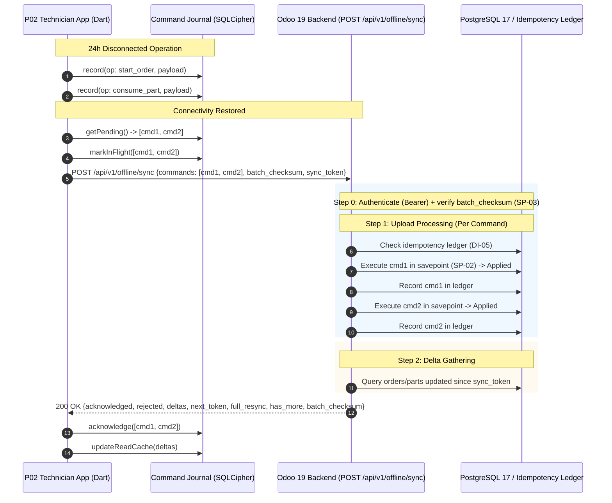

# 1000FiX Offline Synchronization Protocol Specification

**Document Code**: PROT-OFFLINE-SYNC-01  
**Architecture Reference**: AR-010, ADR-024, FL-03  
**Status**: APPROVED / IN PRODUCTION  
**Last Updated**: 22 October 2026 (R01 security re-audit: §6)  

---

## 1. Executive Summary & Core Invariant

The 1000FiX Integrated Smart Platform operates in Bangladesh's challenging field environment where 2G/3G connectivity drops frequently, mobile data is intermittent, and rural/basement job sites have zero signal.

> **Fundamental Invariant (AR-010 §3)**:  
> **"Commands, Not Records."**  
> The client offline store (`fix_offline`) is an append-only command journal, NOT an offline mirror database. The local read cache is NEVER authoritative; it is merely a local projection of the last-known server state.

---

## 2. Invariants & Rules Catalog

| Rule Code | Rule Title | Specification |
|:---|:---|:---|
| **SP-01** | Append-Only Journal | Client mutations append an immutable command with client-generated UUIDv4. Commands are never updated in place except for lifecycle status (`pending`, `in_flight`, `acknowledged`, `rejected`). |
| **SP-02** | Isolated Server Transactions | The server processes batches command-by-command with individual database savepoints. One command's rejection MUST NEVER roll back other valid commands in the batch. |
| **SP-03** | Batch Checksum Integrity | Every upload batch includes a client-computed SHA-256 digest (`batch_checksum`, canonical form in §6.2) verified by the server before transaction dispatch. A missing or mismatching digest rejects the whole batch — no command is executed and nothing is written to the ledger. |
| **SP-07** | Upload-First Sequence | In any sync roundtrip, **upload MUST precede download**. Download-first causes newly recorded technician field actions to temporarily disappear from the UI, provoking duplicate manual inputs. The download contains only records changed after the client's `sync_token` (§6.3). |
| **SP-09** | Deferred Evidence Channel | High-bandwidth media uploads (photos, Bengali voice notes, signature bitmaps) are partitioned into an asynchronous chunked channel (`POST /api/v1/offline/evidence/chunk`). Media queues **NEVER block job status sync**. |
| **DI-05** | Idempotency Ledger | Server tracks every command UUID in `fix.offline.idempotency.ledger`. Replays and network retries return cached JSON results with zero side-effects. |
| **AR-010 §6**| Two-State Disclosure | The UI contract strictly distinguishes between `notYetSynced` (local edits awaiting upload) and `syncedAndRejected` (server rejections). These states **must NEVER be conflated**. |

---

## 3. The Synchronization Lifecycle (SP-07)



---

## 4. Conflict Authority Matrix

When concurrent edits occur or server state changes during technician offline periods:

| Operation | Server Condition | Resolution Authority | Outcome |
|:---|:---|:---|:---|
| `start_order` | Order already marked `in_progress` | Concurrent acceptance | `conflict_applied` (client notified of server start time) |
| `start_order` | Order cancelled by dispatcher | Server authoritative | `rejected` ("Order cancelled on server; technician action disallowed") |
| `start_order` | Order reassigned to other tech | Server authoritative | `rejected` ("Order X was reassigned to another technician") |
| any record command | Record not assigned to the authenticated technician | Server authoritative | `rejected` (unassigned and foreign records are never touched) |
| `complete_order` | Order in valid `in_progress` | Client authoritative | `applied` (order marked completed, resolution notes recorded) |
| `complete_order` | Order already completed | Idempotent | `conflict_applied` (merged state) |
| `consume_part` | Part in van stock | Client authoritative | `applied` (stock line deducted) |
| `clock_in` | Open shift exists | Idempotent | `applied` (`already_clocked_in: True`) |
| `clock_in` | No (or non-numeric) `geo_lat` / `geo_long` | Server authoritative | `rejected` (nothing to evaluate) |
| `clock_in` | Position outside every active geofence of the technician's own zone (`hr.employee.branch_id.zone_id`), the zone has no geofence, the branch has no zone, or the GPS fix is less accurate than the limit (or `accuracy_m` not reported) | Server authoritative — M55 AUT-WFM-02 | `applied`: the attendance is **recorded** (`source` `mobile_offline`) with `geofence_result` `outside` / `no_geofence` / `no_zone` / `low_accuracy` and `approval_state: pending` + `approval_reason` — an attendance officer approves or rejects it; a rejected clock-in is no worked time, and neither the attendance lock nor the payroll run proceeds while a clock-in of the period is pending |
| `clock_out` | No open shift | Server authoritative | `rejected` ("No open attendance shift found") |

---

## 5. Deferred Evidence Channel (SP-09)

Media payloads are split into 512 KB chunks and uploaded via `POST /api/v1/offline/evidence/chunk`:
- Each chunk contains `media_uuid`, `chunk_index`, `total_chunks`, `chunk_data` (base64), and `chunk_hash`.
- Reassembly occurs on final chunk arrival, creating an `ir.attachment` linked to the target record.
- Network stalls on 40 MB photo uploads have zero impact on `/api/v1/offline/sync`.
- The channel is authenticated exactly like the sync endpoint (§6.1). Evidence may only target a
  `fix.field.order` or `fix.work.order` assigned to the authenticated technician; upload sessions are
  keyed by (technician, `media_uuid`), so another device cannot inject chunks into the upload.
  Limits: `total_chunks` ≤ 200, one chunk ≤ 1 MB of base64, `chunk_index` in `[0, total_chunks)`.
- If the reassembled media cannot be stored, the final chunk is answered with
  `{"error": {"code": "assembly_failed"}}` (never `complete`) and the buffered chunks are
  discarded: the client keeps its copy and restarts that upload from chunk 0.

---

## 6. Security & Integrity Contract (R01 re-audit 2026-10-22)

Single implementation: `cd_service_order/controllers/technician_api.py`
(`resolve_technician`, `batch_digest`, `verify_batch_checksum`, `encode_sync_token`,
`parse_sync_token`, `collect_deltas`), shared by `POST /api/v1/offline/sync`,
`POST /technician/offline/sync`, `POST /api/v1/offline/evidence/chunk` and the legacy
`POST /technician/sync`.

### 6.1 Authentication & technician identity

- Every sync / evidence / `/technician/*` route is `auth="bearer"`: an Odoo API key of the technician's
  user in `Authorization: Bearer <key>` (the mobile app), or an authenticated interactive session.
  Anonymous calls are refused by the framework before the controller runs. No CORS header is sent.
- The technician is **always** the `hr.employee` whose `user_id` is the authenticated user. If none
  exists the response is `{"error": {"code": "no_employee"}}`; there is no fallback employee.
- `technician_id` / `employee_id` in a request (or in a replayed command payload) never select the
  technician. A value naming anyone else is refused with `{"error": {"code": "forbidden"}}`.
- Every command acts only on records assigned to that technician; a DI-05 ledger replay returns a cached
  result only to the technician who issued the command.

### 6.2 SP-03 batch checksum (canonical digest)

```
batch_checksum = sha256_hex( utf8( json.dumps(commands, sort_keys=True,
                                              separators=(",", ":"),
                                              ensure_ascii=False, default=str) ) )
```

i.e. the lowercase hex SHA-256 of the UTF-8 bytes of the `commands` array serialised as compact JSON
with object keys sorted at every level and non-ASCII characters (Bengali text) emitted as-is. The
server recomputes it over the received `commands` **before dispatching anything**:

| Condition | Response (whole batch rejected, nothing executed) |
|:---|:---|
| `batch_checksum` absent or empty | `{"error": {"code": "checksum_missing", "message": ...}}` |
| `batch_checksum` ≠ recomputed digest | `{"error": {"code": "checksum_mismatch", "message": ...}}` |

The check is identical on every command-replay route: `POST /api/v1/offline/sync`,
`POST /technician/offline/sync` and the legacy `POST /technician/sync` all take the request field
`batch_checksum` and run `verify_batch_checksum` after authentication and before the first command
(an empty `commands` list is signed too: its digest is the SHA-256 of `[]`).

The response field `batch_checksum` is the *server* digest (16 hex chars over the acknowledged and
rejected command ids) used by the client to reconcile its journal. `/technician/sync` returns its
server digest as `sync.checksum` (16 hex chars over the acknowledged command ids).

### 6.3 SP-07 sync token (delta cursor)

- Format: `TOKEN-<YYYY-MM-DDTHH:MM:SS.ffffff>` (naive UTC, the server-side delta cut), optionally
  followed by `~<record id>` when the previous page was truncated. Clients treat it as opaque and send
  back the last `next_token` (`token` on `/technician/sync`) as `sync_token` (`last_token`).
- Deltas are the technician's records (`fix.field.order` assigned to the technician on
  `/api/v1/offline/sync`; `fix.work.order` on `/technician/sync`) with `write_date > cut`
  (or `write_date = cut AND id > record id` for a `~id` cursor), oldest first, at most 200 per call.
  `has_more: true` means "sync again immediately".
- `next_token` = server transaction time − 60 s. The 60 s overlap re-delivers changes of transactions
  still in flight when the cut was taken (`write_date` is a transaction's start time); re-delivery is
  harmless because the read cache is a non-authoritative projection.
- A missing, malformed or future-dated token means **full resync**: all of the technician's records are
  returned and the response carries `full_resync: true`.

### 6.4 DI-05 command idempotency on every replay route

- `POST /api/v1/offline/sync`, `POST /technician/offline/sync` and the legacy `POST /technician/sync`
  share one idempotency ledger (`fix.offline.idempotency.ledger`, `UNIQUE (command_id)` in the
  database) and one lookup (`ledger_lookup`), keyed by (authenticated technician, `command_id`).
  The client generates a UUID per command (`command_id`, e.g. `crypto.randomUUID()`).
- A command id already **applied** is never executed again. `/api/v1/offline/sync` returns its cached
  response in `acknowledged`; `/technician/sync` returns the original result with
  `"status": "already_applied"` in `sync.acknowledged` and lists the id in `sync.duplicates`
  (`sync.dup_count`) — it is still acknowledged, so the client drops it from its journal. A re-uploaded
  batch (the client lost the response of a successful sync) therefore creates nothing twice.
- A command id already **rejected** returns its recorded reason in `rejected` without re-executing.
  A command id recorded for **another** technician is rejected
  (`"command_id already used by another technician"`).
- The outcome of every executed command is recorded in the same savepoint as its effects (SP-02):
  a command that fails leaves no effect and a `rejected` ledger row.
- `/technician/sync` fails closed with `{"error": {"code": "ledger_unavailable"}}` when the ledger
  model (`cd_field_service`) is not installed: without it a retried batch would re-execute.

### 6.5 Mobile clock-in evaluation (M55 AUT-WFM-02 / T-06)

`/technician/attendance/clock_in` and the offline `clock_in` command share `evaluate_clock_in_position`
(`cd_service_order/controllers/technician_api.py`). The request carries `geo_lat`, `geo_long` (required —
without them the clock-in is refused) and `accuracy_m` (the fix's accuracy radius in metres). The
position is evaluated against the active geofences of the technician's own zone only; the clock-in is
always recorded with its `geofence_result`, and it is **flagged for approval** (`approval_state:
pending`, with `approval_reason`) unless it is inside a fence of that zone with `accuracy_m` within the
limit. The limit is the system parameter `fix.attendance.max_accuracy_m` (no figure is set in M55 /
BRU-WFM; default **100 m**); an unreported or unreadable accuracy is flagged. The online response
returns `geofence_result`, `approval_state` and a message telling the technician the clock-in is pending
supervisor approval.
