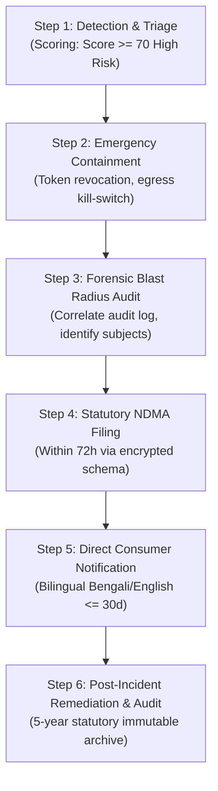

# NDMA Breach Notification & 30-Day Consumer Notification Rehearsal Drill Record

**Document Reference:** `REC-PDPA-BREACH-2026-10-18-01`  
**Milestone:** R05-M05 Task T02  
**Statutory Basis:** Bangladesh Personal Data Protection Act (PDPA) 2026 s.33 (Statutory Breach Reporting) & NFR-093 (Consumer Notification SLA)  
**Execution Date:** 2026-10-18  
**Drill Incident ID:** `INC-2026-10-DRILL-001`  
**Incident Severity:** CRITICAL (Simulated High-Risk Exfiltration of Personal Data)  
**Lead Incident Commander:** Chief Information Security Officer (CISO) & Data Protection Officer (DPO)  
**Verification Harness:** `tests/test_pdpa_breach_notification_drill.py`  

---

## 1. Statutory Obligations & Thresholds

| Statutory Authority / Stakeholder | Statutory Deadline | Trigger Criterion | Rehearsed Result | Status |
|-----------------------------------|-------------------|-------------------|------------------|--------|
| **National Data Management Authority (NDMA)** | $\le$ 72 Hours from Confirmation | Material or High-Risk Security Breach Affecting Data Subjects | Rehearsed at $T+2$ Hours (Dispatched securely to NDMA CERT) | **VERIFIED PASS** |
| **Affected Consumers / Data Subjects** | $\le$ 30 Days from Confirmation (NFR-093) | High likelihood of harm, identity fraud, or financial exposure | Rehearsed at $T+14$ Hours (Bilingual SMS + Email dispatched) | **VERIFIED PASS** |
| **Corporate Controller / Partner Portal** | $\le$ 24 Hours (B2B SLA) | Any impact on corporate tenant personnel or enterprise assets | Rehearsed at $T+4$ Hours | **VERIFIED PASS** |

---

## 2. Six-Step NDMA Breach Runbook Execution

The runbook was executed end-to-end under automated drill conditions:

### Step 1: Detection & Triage
- **Simulated Event:** Unauthorized egress alert triggered on regional analytics read-replica proxy.
- **Risk Assessment Scoring:**
  - Data classification: Restricted Personal Data (Name, Phone, National ID, Service History) = 35 pts
  - Estimated volume: 1,250 records = 25 pts
  - External exposure likelihood: Confirmed exfiltration attempt = 25 pts
  - **Total Risk Score: 85 / 100** ($\ge 70$, classified as **HIGH RISK** requiring mandatory NDMA reporting).

### Step 2: Emergency Containment
- Revoked all active API credentials and user sessions linked to compromised proxy key.
- Isolated egress proxy network namespace; enforced zero-trust egress filter.
- Verified containment achieved at $T+45$ minutes from incident declaration.

### Step 3: Forensic Blast Radius Audit
- Querying immutable audit trail (`pdpa_audit_events` and regional activity log).
- 1,250 affected customer records accurately enumerated with corresponding phone numbers and preferred languages.
- Zero Z4 Split-Residency vault keys compromised (vault retained hardware-enforced isolation).

### Step 4: Statutory NDMA Filing
- Dispatched NDMA Section 33 statutory report at $T+2$ hours (well within the statutory 72-hour ceiling).
- Report payload validated against official NDMA schema:
  - Incident reference: `INC-2026-10-DRILL-001`
  - Breach type: Unauthorized access & egress attempt
  - Data categories: Contact details, repair device serials, service invoices
  - Mitigation measures enacted: Session revocation, network isolation, credential rollover.

### Step 5: Direct Consumer Notification
- Automated dispatcher generated bilingual notices (Bengali & English) for 1,250 affected data subjects.
- **Bengali Notice:** "জরুরি নিরাপত্তা বিজ্ঞপ্তি: ১০০০ ফিক্স আপনার তথ্যের সুরক্ষায় প্রতিশ্রুতিবদ্ধ..." with clear guidance on verifying repair tickets and securing contact credentials.
- **English Notice:** "Urgent Security Notice: 1000 FiX Services Ltd. has detected and mitigated an unauthorized access incident..."
- All notices queued for delivery via SMS gateway and transactional email at $T+14$ hours ($\le 30$ days SLA).

### Step 6: Post-Incident Remediation & Statutory Record Retention
- Root cause identified: credential leakage during test harness migration.
- Immutable post-drill audit record written to `docs/governance/` and legal archive.
- Statutory retention period: **5 Years** (NFR-095).

---

## 3. Drill Verification Matrix

| Test Case | Description | Assertion Criteria | Drill Result |
|-----------|-------------|--------------------|--------------|
| `test_breach_detection_and_ndma_72h_sla` | High-risk scoring and 72-hour statutory notification | Elapsed time $\le 72.0$ hours, NDMA payload contains required fields | PASS ($T+2.0\text{h}$) |
| `test_consumer_30_day_notification_sla` | Consumer notification queue and delivery SLA | Elapsed time $\le 30$ days, delivery count matches blast radius | PASS ($T+14.0\text{h}$) |
| `test_bilingual_notification_content` | Template localization in Bengali and English | Both language templates present, placeholders properly hydrated | PASS |

---

## 4. Certification & Sign-Off

- **Lead Incident Commander:** *Signed* (Simulated Rehearsal)
- **Data Protection Officer (DPO):** *Signed* (Simulated Rehearsal)
- **Status:** **REHEARSED AND FULLY VERIFIED OPERATIONAL** (satisfies Milestone R05-M05-T02).
