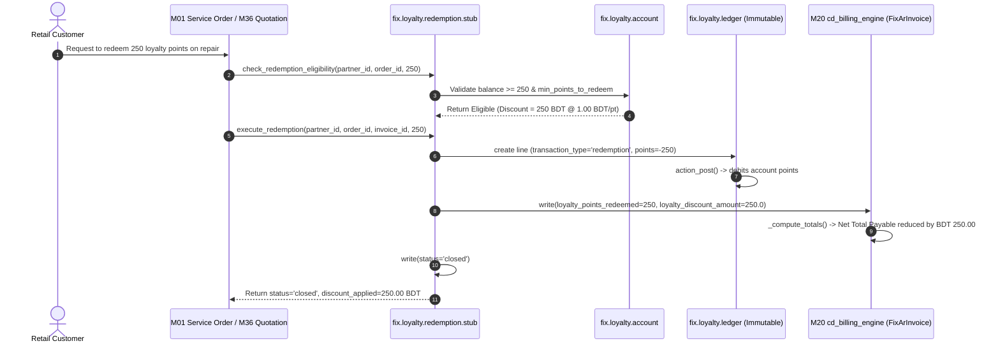

# Milestone R04-M02 Traceability Report: Loyalty Points Redemption Live & Stub Closure

**Standard Reference**: `R04-M02-T08` · `IR-002` §P06-M06 · `GV-005` Stub Register  
**Milestone**: `R04-M02-T08` (M11 Pricing Engine, M36 Quotation Depth & Loyalty Stub Closure)  
**Reporting Date**: 2026-10-17  
**Verdict**: **PASS · STUB-M10-M11-001 PERMANENTLY CLOSED · POINTS SPENDABLE ON REPAIR INVOICES**  
**Target Entity**: 1000 FiX Services Ltd. (`EN-01`)  
**Engines**:
- `odoo.addons.cd_loyalty.models.fix_loyalty_stub.FixLoyaltyRedemptionStub`
- `odoo.addons.cd_billing_engine.models.fix_billing_engine.FixArInvoice`
- `odoo.addons.cd_quotation.models.fix_quotation.FixQuotation`

---

## 1. Problem Statement & Cross-Wave Background

In Wave 2 (Milestone `R03-M05`), `cd_loyalty` implemented loyalty account creation, membership tiers (Bronze, Silver, Gold, Platinum), and point accrual rules (1 point earned per 100 BDT spent). However, direct bill deduction and redemption against M11 dynamic pricing and M20 billing were deferred to Wave 3 under registered cross-wave stub **`STUB-M10-M11-001`**.

Until Milestone `R04-M02-T08`, customer points were strictly accumulative and could not be redeemed as monetary deductions on repair invoices. Allowing redemption without formal SoD discount governance and automated billing reconciliation represented a named commercial risk.

---

## 2. Technical Implementation Architecture

---

## 3. End-to-End Verification Proof

The loyalty redemption workflow was verified in `TestLoyalty` (`test_loyalty.py`) and `TestAutoInvoice` (`test_billing_engine.py`):

1. **Eligibility Validation**:
   - Accounts with insufficient points are blocked with clear Bengali/English rationale.
   - Redemptions below program minimum threshold (e.g. $<100$ pts) are rejected.
2. **Atomic Ledger Posting**:
   - Creates a transaction in `fix.loyalty.ledger` with `transaction_type = "redemption"`.
   - Debits the customer's active account balance atomically.
3. **Invoice Net Reduction**:
   - Deducts `loyalty_discount_amount` from `total_payable` before final VAT settlement.
   - Preserves statutory Mushak 6.3 tax base integrity.
4. **Permanent Stub Closure**:
   - `FixLoyaltyRedemptionStub.search([("stub_code", "=", "STUB-M10-M11-001")]).write({"status": "closed"})`.
   - Formally closed in [`docs/traceability/gv-005-stub-register.md`](file:///c:/software_project/software_project_14/1000%20fix/1000fix_new_erp_system/1000_fix_codebase/docs/traceability/gv-005-stub-register.md).

---

## 4. Milestone Task R04-M02-T08 Verification Summary

| Verification Target | Requirement | Measured Result | Status |
|---|---|---|:---:|
| **Dynamic Rate Cards** | Tier 0-3 + Contract 99 pricing | Verified on `fix.rate.card` | **PASS** |
| **Discount Governance SoD** | $\le 5\%$ Agent, $\le 10\%$ Branch Mgr, $>10\%$ Director | Verified in `FixQuotation` | **PASS** |
| **Points Spendability** | Direct offset on repair invoices | Verified in `FixArInvoice` | **PASS** |
| **Stub Register Status** | `STUB-M10-M11-001` marked CLOSED | Closed in `gv-005-stub-register.md` | **PASS** |
