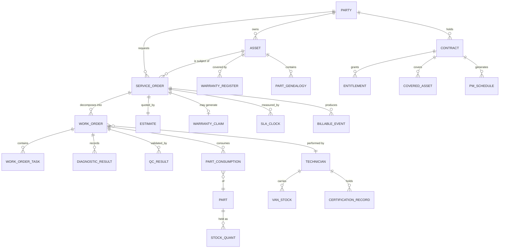
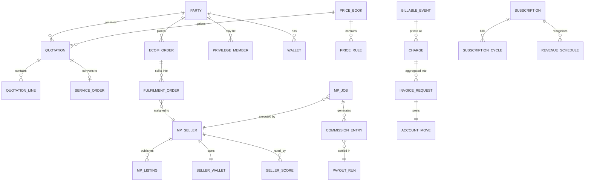
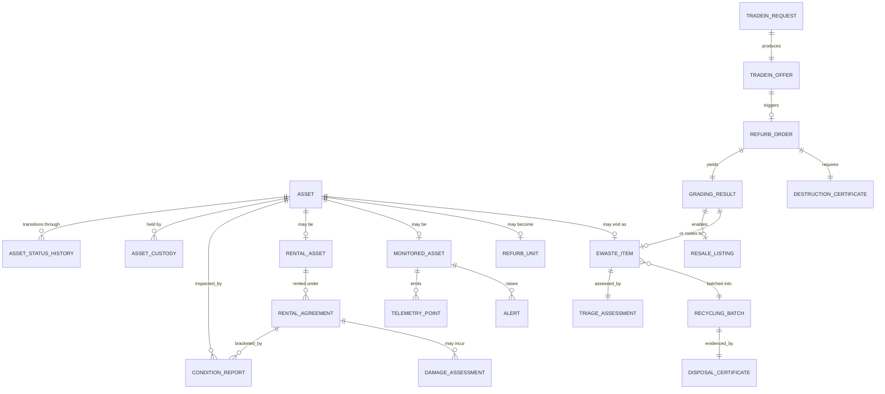
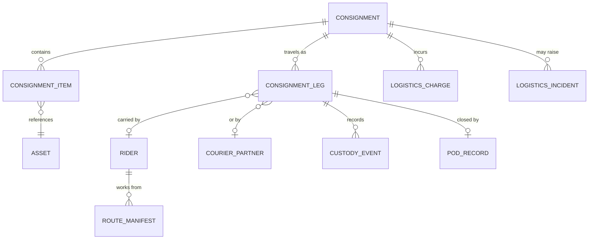
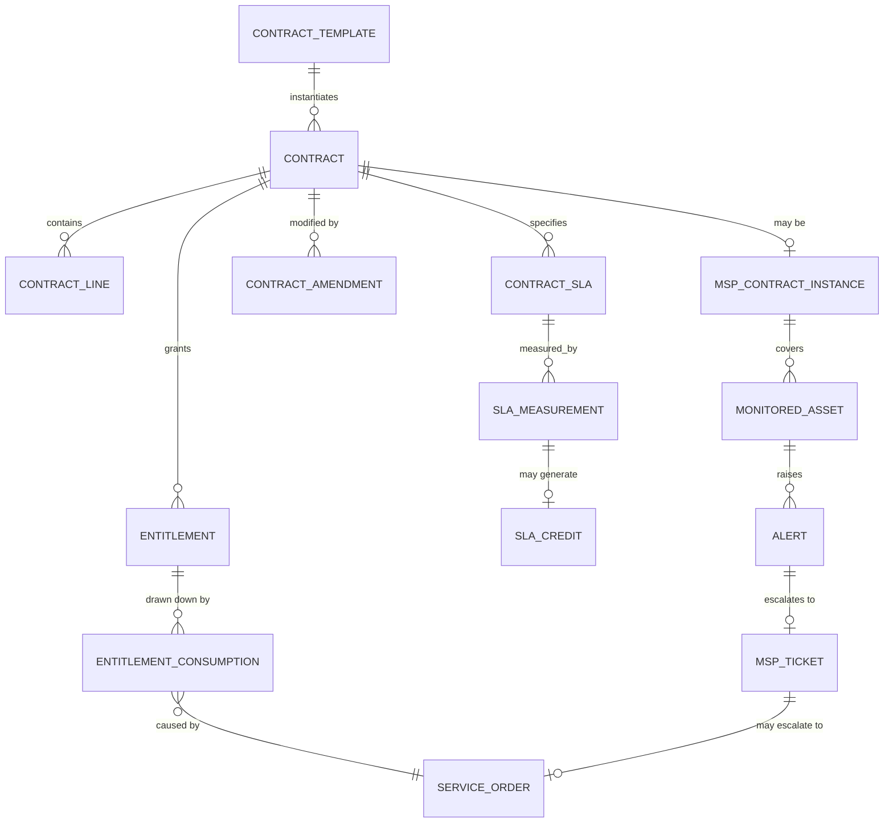

# Data Model & Entity Catalog
# 225 Entities Across 30 Modules

---

## 1. Modelling Standards

Carried forward from the v1.0 Database Schema Specification and extended.

| # | Standard | Detail |
|---|---|---|
| DM-01 | Naming | Odoo models prefixed `fix.`; tables prefixed `fix_`; snake_case columns |
| DM-02 | Three-tier hierarchy | Odoo native → OCA extension → custom `cd_*` module |
| DM-03 | Dimensional context | Every transactional model carries `company_id`, `operating_unit_id`, and where relevant `zone_id`, `cost_center_id`, `business_line_id` |
| DM-04 | Chatter & activity | Every business model inherits `mail.thread` and `mail.activity.mixin` |
| DM-05 | Audit fields | `create_uid`, `create_date`, `write_uid`, `write_date` on all; plus explicit audit entries for controlled objects |
| DM-06 | Soft delete | Business records are archived (`active = False`), never hard-deleted |
| DM-07 | Money | `Monetary` fields with an explicit `currency_id`; never floats |
| DM-08 | Time | Stored UTC; presented in `Asia/Dhaka`; durations stored in minutes |
| DM-09 | Text | UTF-8 throughout; Bengali collation `bn_BD` with ICU fallback for sorting |
| DM-10 | State machines | An explicit `state` selection field with the transition map declared in one place |
| DM-11 | Sequences | Branch- and business-line-aware sequences with configurable masks |
| DM-12 | Referential integrity | Foreign keys enforced at the database level; `ondelete` policy declared explicitly |
| DM-13 | Extension pattern | Business-line specialisation via one-to-one extension models, not by widening the core model |
| DM-14 | Sensitive data | Fields classified S0–S3 (see §10); S3 fields encrypted and access-logged |
| DM-15 | Events | Every state change writes to the outbox table in the same transaction |

---

## 2. Shared Kernel Entities

| Entity | Table | Basis | Purpose |
|---|---|---|---|
| `fix.party` | `res_partner` (ext) | Odoo | Every person or organisation the Company deals with |
| `fix.party.role` | `fix_party_role` | Custom | The roles a party holds — customer, employee, vendor, seller, brand, referrer |
| `fix.party.hierarchy` | `fix_party_hierarchy` | Custom | Group → company → division → site relationships |
| `fix.entity` | `res_company` (ext) | Odoo | Legal entity with tax identity, currency, fiscal calendar |
| `fix.branch` | `operating_unit` (ext) | OCA | Service centre / operating unit |
| `fix.zone` | `fix_zone` | Custom | Dispatch and territory zone |
| `fix.cost.center` | `fix_cost_center` | Custom | Financial reporting dimension |
| `fix.business.line` | `fix_business_line` | Custom | Revenue-stream dimension |
| `fix.address` | `fix_address` | Custom | Tagged address with Bangladesh hierarchy and GPS |
| `fix.catalogue.item` | `product_template` (ext) | Odoo | Anything sellable: service, part, kit, rental SKU, refurbished unit, subscription |
| `fix.document` | `fix_document` | Custom | Any stored document with class, retention and version |
| `fix.domain.event` | `fix_domain_event` | Custom | The transactional outbox |

### Bangladesh Address Hierarchy

```
res.country (Bangladesh)
   └── res.country.state          → 8 Divisions
         └── fix.district          → 64 Districts
               └── fix.upazila     → ~495 Upazilas / Thanas
                     └── fix.union_ward → Unions / Wards
                           └── fix.address (street, holding, postcode, lat, lng, tag)
```

---

## 3. Pillar A Entities — Core Service Operations

### 3.1 M01 SRM (26 entities)

| Entity | Key Attributes | Relationships |
|---|---|---|
| `fix.service.order` | name, partner_id, asset_id, order_type, channel, state, priority, branch_id, business_line_id, sla_policy_id, promised_date, total_cost, total_price | 1:N work orders, 1:1 estimate, 1:N events |
| `fix.service.order.rental` | rental_agreement_id, swap_required | 1:1 service order |
| `fix.service.order.msp` | msp_contract_id, alert_id, ticket_ref | 1:1 service order |
| `fix.service.order.data` | data_case_id, confidentiality_level | 1:1 service order |
| `fix.service.order.marketplace` | seller_id, offer_id, commission_scheme_id | 1:1 service order |
| `fix.work.order` | service_order_id, technician_id, scope, scheduled_start, actual_start, actual_end, state, repair_level | N:1 service order |
| `fix.work.order.task` | work_order_id, sequence, description, status, duration_min | N:1 work order |
| `fix.job.batch` | name, partner_id, site_id, planned_date, order_ids | 1:N service orders |
| `fix.diagnostic.template` | asset_category_id, brand_id, model_id, symptom_id, tree_json, version | referenced by results |
| `fix.diagnostic.result` | work_order_id, template_id, answers_json, findings, completed_by | N:1 work order |
| `fix.fault.code` | code, category, sub_category, description_bn, description_en | referenced widely |
| `fix.estimate` | service_order_id, version, state, valid_until, subtotal, tax, total, cost, margin | 1:N lines |
| `fix.estimate.line` | estimate_id, item_id, qty, unit_price, unit_cost, discount, line_type | N:1 estimate |
| `fix.approval.request` | model, res_id, approver_id, level, state, decided_at, reason | polymorphic |
| `fix.qc.checklist` | template_id, applicable_category, repair_level, items_json | referenced by results |
| `fix.qc.result` | work_order_id, checklist_id, passed, inspector_id, evidence_ids | N:1 work order |
| `fix.hold.reason` | code, description, suspends_sla | referenced by orders |
| `fix.rework.link` | original_order_id, rework_order_id, fault_code_id, days_between, attributed_to | links two orders |
| `fix.sla.policy` | name, service_type, business_line, tier, response_min, resolution_min, calendar_id | referenced by orders |
| `fix.sla.clock` | service_order_id, clock_type, started_at, paused_total_min, breached, breach_at | N:1 service order |
| `fix.escalation.rule` | sla_policy_id, threshold_pct, role_id, action | referenced by clocks |
| `fix.workshop.bench` | branch_id, code, capability, current_work_order_id | 1:N work orders |
| `fix.custody.event` | model, res_id, from_party, to_party, occurred_at, gps, evidence_id | polymorphic |
| `fix.service.report` | service_order_id, findings, work_done, parts, warranty_terms, document_id | 1:1 service order |
| `fix.repair.warranty` | service_order_id, asset_id, start_date, end_date, scope, claimed | 1:1 service order |
| `fix.device.condition.log` | asset_id, event_type, cosmetic_grade, functional_notes, evidence_ids | N:1 asset |

### 3.2 M02 FSM (16 entities)

`fix.dispatch.job` · `fix.assignment.score` · `fix.technician.profile` · `fix.technician.shift` ·
`fix.zone` (kernel) · `fix.geofence` · `fix.route.plan` · `fix.route.stop` ·
`fix.location.ping` *(TimescaleDB hypertable)* · `fix.visit` · `fix.visit.exception` ·
`fix.van.stock` · `fix.van.replenishment` · `fix.field.session` · `fix.offline.journal` ·
`fix.crew`

### 3.3 M03 LOG (11 entities)

`fix.consignment` · `fix.consignment.leg` · `fix.consignment.item` · `fix.custody.event` (shared) ·
`fix.rider` · `fix.route.manifest` · `fix.courier.partner` · `fix.courier.rate` ·
`fix.pod.record` · `fix.logistics.charge` · `fix.logistics.incident`

### 3.4 M04 FRD (8 entities)

`fix.queue.token` · `fix.queue.counter` · `fix.queue.config` · `fix.branch.shift` ·
`fix.cash.drawer` · `fix.cash.movement` · `fix.storage.location` · `fix.branch.checklist`

### 3.5 M05 RMS (16 entities)

`fix.msp.contract.instance` · `fix.monitored.asset` · `fix.monitor.agent` ·
`fix.metric.series` *(TimescaleDB)* · `fix.alert.rule` · `fix.alert` · `fix.msp.ticket` ·
`fix.problem.record` · `fix.change.record` · `fix.remote.session` · `fix.patch.job` ·
`fix.runbook` · `fix.oncall.rota` · `fix.maintenance.window` · `fix.service.review` ·
`fix.sla.credit`

### 3.6 M06 DTS (12 entities)

`fix.data.case` · `fix.media.item` · `fix.media.custody.event` · `fix.recovery.attempt` ·
`fix.recovered.inventory` · `fix.backup.plan` · `fix.backup.run` · `fix.restore.test` ·
`fix.wipe.request` · `fix.destruction.certificate` · `fix.cleanroom.booking` ·
`fix.data.access.log`

---

## 4. Pillar B Entities — Customer, Commercial & Revenue

### 4.1 M07 CRM (16) · M08 CTR (14) · M09 WTY (13) · M10 LOY (15)

| Module | Entities |
|---|---|
| M07 | `fix.party` (kernel) · `fix.party.role` · `fix.party.hierarchy` · `fix.customer.profile` · `fix.address` · `fix.contact.verification` · `fix.identity.document` · `fix.consent.record` · `fix.segment` · `fix.customer.health` · `fix.lead` · `fix.opportunity` · `fix.activity` · `fix.complaint` · `fix.survey.response` · `fix.credit.profile` |
| M08 | `fix.contract` · `fix.contract.template` · `fix.contract.line` · `fix.contract.covered.asset` · `fix.entitlement` · `fix.entitlement.consumption` · `fix.contract.sla` · `fix.sla.measurement` · `fix.sla.credit` · `fix.pm.schedule` · `fix.pm.visit` · `fix.contract.amendment` · `fix.renewal.opportunity` · `fix.contract.cost.line` |
| M09 | `fix.warranty.register` · `fix.warranty.product` · `fix.warranty.policy` · `fix.warranty.assessment` · `fix.warranty.claim` · `fix.claim.evidence` · `fix.claim.line` · `fix.brand.rule` · `fix.brand.rate.card` · `fix.claim.response` · `fix.claim.remittance` · `fix.warranty.reserve` · `fix.consignment.part.usage` |
| M10 | `fix.privilege.tier` · `fix.privilege.member` · `fix.benefit.rule` · `fix.points.ledger` · `fix.wallet` · `fix.wallet.transaction` · `fix.voucher` · `fix.voucher.redemption` · `fix.offer.rule` · `fix.referral.code` · `fix.referral.conversion` · `fix.alliance.partner` · `fix.campaign` · `fix.campaign.audience` · `fix.campaign.result` |

### 4.2 M11 SLS (12) · M12 ECM (22) · M13 RNT (12) · M14 TRF (13)

| Module | Entities |
|---|---|
| M11 | `fix.price.book` · `fix.price.rule` · `fix.rate.card` · `fix.service.kit` · `fix.quotation` · `fix.quotation.line` · `fix.quotation.version` · `fix.discount.policy` · `fix.offer` · `fix.bid` · `fix.pricing.decision.log` · `fix.price.experiment` |
| M12 | `fix.mp.seller` · `fix.mp.seller.document` · `fix.mp.seller.agreement` · `fix.mp.listing` · `fix.mp.listing.variant` · `fix.ecom.order` · `fix.ecom.order.line` · `fix.fulfilment.order` · `fix.mp.job` · `fix.mp.offer` · `fix.mp.chat.thread` · `fix.mp.chat.message` · `fix.review` · `fix.review.moderation` · `fix.seller.score` · `fix.commission.scheme` · `fix.commission.entry` · `fix.seller.wallet` · `fix.payout.run` · `fix.ad.placement` · `fix.ad.campaign` · `fix.dispute.case` |
| M13 | `fix.rental.asset` · `fix.rental.category` · `fix.rental.kit` · `fix.rental.reservation` · `fix.rental.agreement` · `fix.rental.line` · `fix.rental.tariff` · `fix.rental.deposit` · `fix.condition.report` · `fix.damage.assessment` · `fix.rental.extension` · `fix.asset.utilisation` |
| M14 | `fix.tradein.request` · `fix.tradein.valuation` · `fix.tradein.offer` · `fix.provenance.record` · `fix.refurb.order` · `fix.refurb.cost.line` · `fix.grading.standard` · `fix.grading.result` · `fix.qa.test.result` · `fix.refurb.unit` · `fix.resale.listing` · `fix.refurb.warranty` · `fix.harvest.record` |

---

## 5. Pillar C Entities — Supply Chain & Assets

| Module | Count | Entities |
|---|---:|---|
| M15 INV | 17 | `fix.part` · `fix.part.compatibility` · `fix.part.supersession` · `fix.part.class` · `fix.service.kit.def` · `fix.stock.location` · `fix.van.stock` · `fix.consignment.stock` · `stock.move` (ext) · `fix.stock.reservation` · `fix.transfer.request` · `fix.cycle.count` · `fix.count.variance` · `fix.landed.cost` · `fix.rtv.record` · `fix.stock.alert` · `fix.replenishment.param` |
| M16 SCM | 16 | `fix.vendor.profile` · `fix.vendor.qualification` · `fix.vendor.scorecard` · `fix.vendor.pricelist` · `fix.purchase.requisition` · `fix.rfq` · `fix.rfq.response` · `purchase.order` (ext) · `fix.grn` · `fix.inspection.result` · `fix.three.way.match` · `fix.debit.note` · `fix.import.order` · `fix.letter.of.credit` · `fix.landed.cost.allocation` · `fix.subcontract.order` |
| M17 AST | 18 | `fix.asset` · `fix.asset.category` · `fix.brand` · `fix.model` · `fix.asset.identifier` · `fix.asset.ownership` · `fix.asset.custody` · `fix.asset.status.history` · `fix.asset.service.history` · `fix.part.genealogy` · `fix.asset.estate` · `fix.maintenance.plan` · `fix.calibration.record` · `fix.telemetry.stream` · `fix.telemetry.point` *(TimescaleDB)* · `fix.asset.health` · `fix.failure.prediction` · `fix.tool.register` |
| M18 ESG | 10 | `fix.ewaste.collection` · `fix.ewaste.item` · `fix.triage.assessment` · `fix.recycling.partner` · `fix.recycling.batch` · `fix.transfer.note` · `fix.disposal.certificate` · `fix.material.recovery` · `fix.hazmat.record` · `fix.esg.metric` |

---

## 6. Pillar D Entities — Finance, People & Governance

| Module | Count | Entities |
|---|---:|---|
| M19 FIN | 17 | `account.move` (ext) · `fix.posting.rule` · `fix.dimension.set` · `fix.mushak.invoice` · `fix.vat.register` · `fix.vat.return` · `fix.tds.record` · `fix.tds.challan` · `fix.bank.account` · `account.bank.statement.line` (ext) · `fix.gateway.settlement` · `fix.cash.position` · `fix.fixed.asset` · `fix.depreciation.schedule` · `fix.budget` · `fix.close.checklist` · `fix.fx.revaluation` |
| M20 BIL | 19 | `fix.billable.event` · `fix.charge` · `fix.invoice.request` · `fix.subscription` · `fix.subscription.cycle` · `fix.usage.record` · `fix.consolidated.invoice` · `fix.dunning.sequence` · `fix.payment.plan` · `fix.revenue.schedule` · `fix.performance.obligation` · `fix.commission.entry` · `fix.seller.statement` · `fix.payout.run` · `fix.payout.line` · `fix.escrow.holding` · `fix.refund.request` · `fix.sla.credit.application` · `fix.warranty.liability` |
| M21 HRM | 21 | `hr.employee` (ext) · `fix.employment.contract` · `fix.org.position` · `fix.onboarding.task` · `fix.attendance.record` · `fix.attendance.exception` · `fix.shift.pattern` · `fix.roster` · `fix.overtime.request` · `hr.leave` (ext) · `fix.holiday.calendar` · `fix.salary.structure` · `hr.payslip` (ext) · `fix.tax.computation` · `fix.pf.record` · `fix.gratuity.provision` · `fix.beftn.file` · `fix.incentive.scheme` · `fix.incentive.calculation` · `fix.employee.kpi` · `fix.expense.claim` |
| M22 LMS | 14 | `fix.competency` · `fix.competency.level` · `fix.role.profile` · `fix.employee.competency` · `fix.certification` · `fix.certification.record` · `fix.course` · `fix.course.content` · `fix.learning.path` · `fix.enrolment` · `fix.assessment` · `fix.assessment.result` · `fix.training.session` · `fix.seller.qualification` |
| M23 QMS | 18 | `fix.standard.clause` · `fix.policy.document` · `fix.process.register` · `fix.risk.register` · `fix.management.review` · `fix.quality.objective` · `fix.checklist.template` · `fix.inspection.result` · `fix.nonconformance` · `fix.root.cause` · `fix.capa` · `fix.capa.verification` · `fix.complaint` (shared) · `fix.audit.plan` · `fix.audit.execution` · `fix.audit.finding` · `fix.security.incident` · `fix.soa.control` |
| M24 DMS | 12 | `fix.document` (kernel) · `fix.document.class` · `fix.document.version` · `fix.document.template` · `fix.signature.envelope` · `fix.signature.event` · `fix.approval.chain` · `fix.retention.schedule` · `fix.legal.hold` · `fix.disposal.record` · `fix.evidence.pack` · `fix.document.access.log` |

---

## 7. Pillar E Entities — Intelligence & Platform

| Module | Count | Entities |
|---|---:|---|
| M25 BID | 8 + warehouse | `fix.metric.definition` · `fix.dataset` · `fix.dashboard` · `fix.report.definition` · `fix.report.schedule` · `fix.data.quality.test` · `fix.data.lineage` · `fix.feature.store` · plus warehouse dims and facts (§9) |
| M26 AIM | 11 | `fix.ml.feature` · `fix.ml.feature.set` · `fix.ml.model` · `fix.ml.model.version` · `fix.ml.prediction.log` · `fix.ml.override` · `fix.ml.drift.metric` · `fix.ml.experiment` · `fix.model.card` · `fix.llm.session` · `fix.llm.citation` |
| M27 CCE | 16 | `fix.conversation` · `fix.conversation.message` · `fix.channel.connector` · `fix.call.record` · `fix.ivr.flow` · `fix.agent.session` · `fix.agent.queue` · `fix.disposition.code` · `fix.canned.response` · `fix.assistant.session` · `fix.assistant.intent` · `fix.notification.template` · `fix.notification.log` · `fix.notification.preference` · `fix.inbox.item` · `fix.quality.evaluation` |
| M28 IPF | 15 | `fix.api.consumer` · `fix.api.credential` · `fix.api.usage.log` · `fix.domain.event` (kernel) · `fix.event.schema` · `fix.event.subscription` · `fix.event.delivery` · `fix.dead.letter` · `fix.integration.config` · `fix.integration.credential` · `fix.webhook.endpoint` · `fix.webhook.delivery` · `fix.sync.state` · `fix.sync.conflict` · `fix.batch.job.run` |
| M29 SEC | 14 | `fix.identity` · `fix.role` · `fix.permission.set` · `fix.record.rule` · `fix.field.permission` · `fix.delegation` · `fix.sod.rule` · `fix.access.request` · `fix.access.certification` · `fix.audit.entry` · `fix.data.access.log` · `fix.security.event` · `fix.encryption.key.ref` · `fix.vulnerability` |
| M30 ADM | 17 | `fix.entity` · `fix.branch` · `fix.zone` · `fix.cost.center` · `fix.business.line` · `fix.working.calendar` · `fix.master.data.domain` · `fix.mdm.change.request` · `fix.config.parameter` · `fix.config.version` · `fix.feature.flag` · `fix.locale.pack` · `fix.country.pack` · `fix.translation.entry` · `fix.system.announcement` · `fix.scheduled.job` · `fix.archive.policy` |

---

## 8. Core Entity Relationship Diagrams

### 8.1 Service Delivery Core



### 8.2 Commercial & Revenue



### 8.3 Asset Lifecycle Across Business Lines



### 8.4 Logistics & Custody



### 8.5 Contract, Entitlement & Managed Services



---

## 9. Analytical Model (Warehouse)

### Conformed Dimensions

| Dimension | Grain | Key Attributes | SCD |
|---|---|---|---|
| `dim_date` | Day | date, week, month, quarter, fiscal period, Bangladesh holiday flag, Ramadan flag | — |
| `dim_time` | Minute | hour, minute, shift, peak flag | — |
| `dim_customer` | Customer | class, segment, tier, division, district, acquisition source, first/last transaction | Type 2 |
| `dim_asset` | Asset | category, brand, model, age band, ownership, condition grade | Type 2 |
| `dim_employee` | Employee | role, grade, branch, zone, skills, certifications, tenure band | Type 2 |
| `dim_branch` | Branch | division, district, size band, opening date, service capabilities | Type 2 |
| `dim_business_line` | Business line | pillar, revenue stream, margin class | Type 1 |
| `dim_part` | Part | category, class, brand, ABC/XYZ, supersession chain | Type 2 |
| `dim_vendor` | Vendor | type, country, tier, performance band | Type 2 |
| `dim_seller` | Marketplace seller | type, tier, categories, rating band, area | Type 2 |
| `dim_contract` | Contract | family, product, term, value band | Type 2 |
| `dim_fault` | Fault code | category, sub-category, severity | Type 1 |
| `dim_channel` | Channel | channel, sub-channel, device type | Type 1 |

### Fact Tables

| Fact | Grain | Key Measures |
|---|---|---|
| `fact_service_order` | Service order | count, TAT minutes, SLA breach flag, revenue, cost, margin, first-time-fix flag, rework flag |
| `fact_work_order` | Work order | labour minutes, travel minutes, parts cost, revisit flag |
| `fact_dispatch` | Assignment decision | candidates considered, auto-assigned flag, override flag, score |
| `fact_technician_day` | Technician × day | jobs, hours worked, hours on job, travel, utilisation, earnings |
| `fact_inventory_movement` | Stock move | quantity, value, location from/to, reason |
| `fact_inventory_snapshot` | Part × location × day | on hand, reserved, value, days of supply |
| `fact_invoice` | Invoice line | amount, tax, discount, cost, margin |
| `fact_payment` | Payment | amount, method, days to pay |
| `fact_warranty_claim` | Claim | claimed, approved, paid, days to submit, days to pay, rejection flag |
| `fact_contract_period` | Contract × period | recurring revenue, entitlement used, delivery cost, margin, SLA attainment |
| `fact_marketplace_order` | Marketplace order | GMV, commission, fees, seller payout, dispute flag |
| `fact_rental_period` | Rental asset × day | on rent flag, revenue, damages, utilisation |
| `fact_refurb_unit` | Refurbished unit | acquisition cost, refurb cost, sale price, margin, days in stock |
| `fact_conversation` | Conversation | duration, channel, AI resolved flag, transfers, CSAT |
| `fact_msp_alert` | Alert | time to acknowledge, time to resolve, auto-remediated flag |
| `fact_quality_event` | NCR / complaint / rework | severity, days to close, recurrence flag, cost of quality |
| `fact_ewaste` | E-waste item | weight, disposition, material recovered value |

---

## 10. Data Classification

Every field is classified. Classification drives encryption, masking, access logging and retention.

| Class | Description | Examples | Controls |
|---|---|---|---|
| **S0 — Public** | No restriction | Service catalogue, branch addresses, published prices | None |
| **S1 — Internal** | Business data, staff-visible | Service orders, stock levels, schedules | RBAC |
| **S2 — Confidential** | Restricted business or personal data | Customer contact details, pricing, margins, salaries in aggregate | RBAC + field permissions + access log |
| **S3 — Restricted** | Highest sensitivity | NID numbers, bank details, individual payroll, recovered customer data, call recordings, biometric templates | Field-level encryption + explicit grant + step-up authentication + full access log + retention enforcement |

### S3 Field Inventory

| Field | Entity | Additional Control |
|---|---|---|
| National ID number | `fix.identity.document` | Encrypted; visible only to finance and compliance roles |
| Bank account details | `fix.party`, `hr.employee` | Encrypted; masked except last four digits |
| Individual salary and payslip | `hr.payslip`, `fix.salary.structure` | Encrypted; visible to the employee and HR/finance only |
| Recovered customer data index | `fix.recovered.inventory` | Encrypted with per-case keys; access restricted to case-assigned staff; dual control |
| Call recordings | `fix.call.record` | Encrypted; access logged; retention enforced |
| Biometric attendance templates | `fix.attendance.record` | Stored as irreversible templates; never exported |
| Seller KYC documents | `fix.mp.seller.document` | Encrypted; visible to onboarding and compliance roles only |
| Customer identity documents | `fix.identity.document` | Encrypted; access logged |
| API and integration credentials | `fix.integration.credential` | Vault-stored; never displayed after creation |

---

## 11. Key Indexes and Performance Design

| Table | Index | Purpose |
|---|---|---|
| `fix_service_order` | `(operating_unit_id, state, create_date DESC)` | Branch operations board |
| `fix_service_order` | `(partner_id, create_date DESC)` | Customer 360 history |
| `fix_service_order` | `(asset_id, create_date DESC)` | Device history and rework detection |
| `fix_service_order` | GIN on `name`, complaint text | Free-text search including Bengali |
| `fix_work_order` | `(technician_id, scheduled_start)` | Technician schedule |
| `fix_sla_clock` | `(breach_at) WHERE NOT breached` | Escalation scanning |
| `fix_asset` | `(serial_no)`, `(imei)`, `(asset_tag)` unique partial | Identity resolution |
| `fix_warranty_claim` | `(brand_id, state, submitted_date)` | Claim pipeline and ageing |
| `fix_stock_quant` | `(product_id, location_id)` | Availability lookup |
| `fix_entitlement` | `(contract_id, asset_id)` | Coverage validation at intake |
| `fix_commission_entry` | `(seller_id, period, state)` | Payout runs |
| `fix_location_ping` | TimescaleDB hypertable on `time`, partition by `technician_id` | GPS history |
| `fix_telemetry_point` | TimescaleDB hypertable on `time`, partition by `asset_id` | Telemetry |
| `fix_domain_event` | `(published, occurred_at)` | Outbox drain |
| `fix_audit_entry` | `(model, res_id, occurred_at DESC)` | Audit lookup |

### Partitioning

| Table | Strategy |
|---|---|
| `fix_service_order`, `fix_work_order` | Range partition by `create_date` (yearly) from year 3 |
| `account_move`, `account_move_line` | Range partition by fiscal period |
| `fix_location_ping`, `fix_telemetry_point`, `fix_metric_series` | TimescaleDB automatic chunking with compression after 7 days |
| `fix_notification_log`, `fix_api_usage_log` | Range partition by month, dropped per retention policy |

---

## 12. Data Migration Sources

| Source | Data | Volume | Target | Wave |
|---|---|---|---|---|
| Customer spreadsheets | Customer master | 100,000+ | M07 | W1 |
| Device registry spreadsheets | Customer devices | 200,000+ | M17 | W1 |
| Service history spreadsheets and paper | Past service orders | 500,000+ | M01 (archive) | W2 |
| Accounting software export | Invoices, payments, GL (3 years) | 1,000,000+ | M19 | W3 |
| Branch inventory spreadsheets | Stock across 51+ locations | 10,000 SKUs × 51 | M15 | W2 |
| HR spreadsheets and files | Employee records | 500+ | M21 | W5 |
| Vendor spreadsheets | Vendor master | 200+ | M16 | W3 |
| Contract spreadsheets | AMC / RAMC / corporate | 5,000+ | M08 | W4 |
| Paper archive | Service reports, warranty documents | TBD | M24 | W3–W6 |
| `station.1000fix.com` | Order tracking records | TBD | M01 | W2 |
| Brand partner portals | Open warranty claims | ~2,000 | M09 | W4 |

### Migration Standards

| # | Standard |
|---|---|
| MIG-01 | Every migration is preceded by a profiling report quantifying completeness, validity and duplication |
| MIG-02 | Cleansing happens in the source or a staging layer, never silently during load |
| MIG-03 | Every load is reversible; a dry run precedes every production load |
| MIG-04 | Reconciliation counts and control totals are signed off by the business owner before cutover |
| MIG-05 | Legacy identifiers are preserved on every migrated record for lookup and audit |
| MIG-06 | Historical records that cannot be cleansed are loaded to an archive area, flagged, and excluded from operational logic |
| MIG-07 | A two-week parallel run applies to service orders and finance before legacy decommission |

---

*Next document: `13_Integration_and_API_Catalog.md`*
