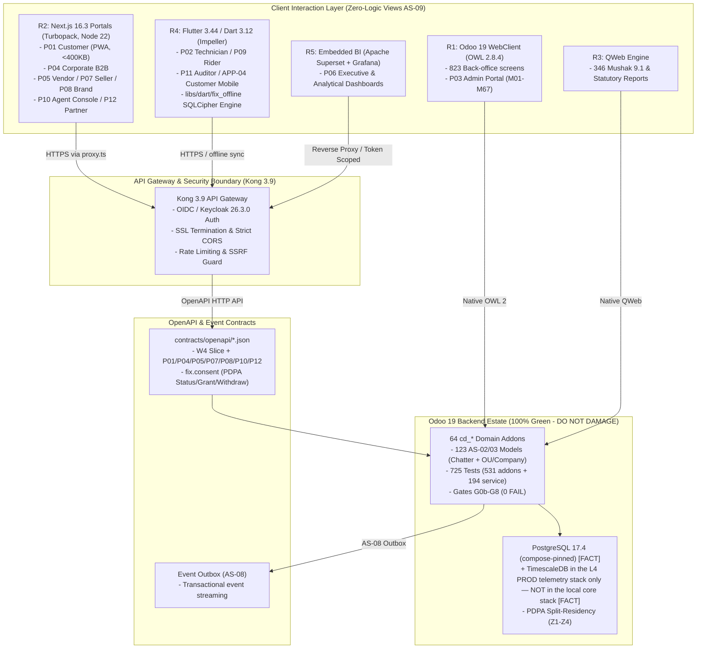
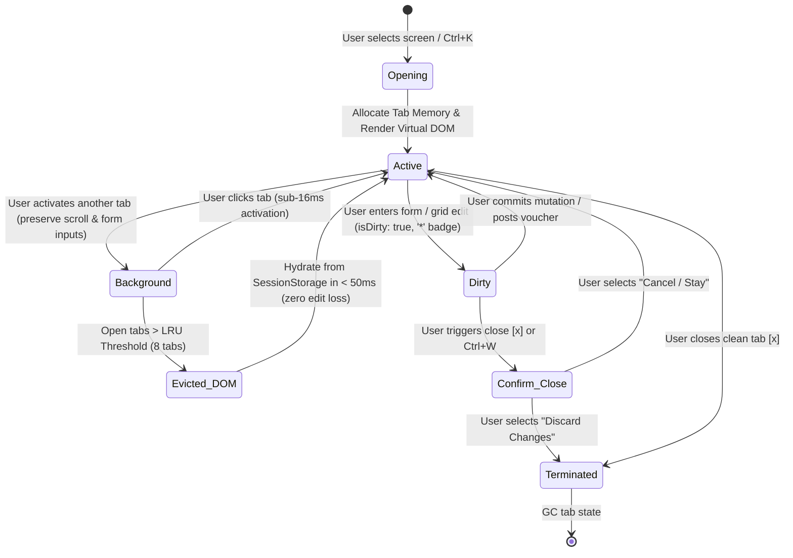
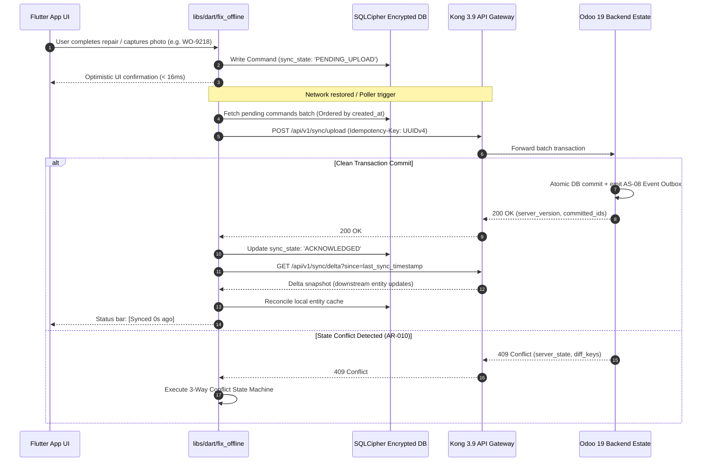

# Architecture State — 1000FiX ERP v2.0 Prototype Porting

**Status**: DESIGN TARGET (partially normative — see the verification banner) · **Date**: 2026-10-05 · **Audited**: 2026-10-05, forensic pass (see `ITERATIONS.md`)

> **Provenance & epistemic status (added by the 2026-10-05 forensic audit).**
> This document mixes two kinds of content and each section is now labelled:
> - **[FACT]** — verified against the workspace this date (vendored source,
>   compose pins, generated artefacts, the live registry).
> - **[TARGET]** — a *proposed* design for PP1+. Nothing in a TARGET section
>   exists in the codebase today; none of it is a porting *requirement*
>   unless the roadmap or the prototype sources it. Performance figures in
>   TARGET sections (60 FPS, sub-50ms, 10k rows) are aspirations to be
>   benchmarked, not criteria.
> Sections whose entire content was unsourced or from another business
> domain have been corrected or removed in-place; the forensic audit record
> (`AUDIT_REPORT.md` §findings A-1…A-9) lists every correction.

---

## 1. High-Level Dependency Graph & Service-Tier Architecture



---

## 2. 6-Point Omni-Navigation Framework  
> **[TARGET — design proposal]** The prototype's own navigation is the normative source (command bar, left nav, mega menus, Tell-ME, tab rail, breadcrumbs — Part-2 contract A13/A2). The 6-point framing below is an organising lens for PP3's shell; the specific widgets (bottom status bar, lateral dropdown switchers) are options, not requirements.

Every external portal (R2) and administrative workspace (R1) implements the **Omni-Navigation Matrix**:

```
+-----------------------------------------------------------------------------------------------------------------------+
| 1. GLOBAL COMMAND HEADER: [App Switcher] [Tenant/OU Context: 1000FiX Corporate v] [Search: Ctrl+K] [Alerts] [User]   |
+-----------------------------------------------------------------------------------------------------------------------+
| 5. MDI TAB BAR: [Pin: Live NAV] [Trade Netting] [x Farhana: JV-2026-0042 *] [x Service Order: SO-4912] [+] [Tabs v]  |
+-----------------------------------------------------------------------------------------------------------------------+
| 4. BREADCRUMBS: Corporate > Invoices > Consolidated Invoices [v] > Job Details #400                                    |
+-------------------+---------------------------------------------------------------------------------------------------+
| 2. CONTEXTUAL     | 6. MAIN ACTIVE WORKSPACE (High-Density Virtualized Split View / MDI Tab Document)                 |
| PRIMARY SIDEBAR   |                                                                                                   |
|                   | [Master Grid: Service Orders (Virtualized)]  | [Detail Pane: Invoice Reconciliation & BPF]        |
| [Icons + Labels]  | - SO-9941: Display Panel (Matched)           | - Gross Consideration: BDT 14,225,000.00           |
| - Front Desk      | - SO-9942: Motherboard BGA (In Progress)     | - VAT (Mushak 9.1, 15%): BDT 2,862.78               |
| - Work Orders     | - SO-9943: Battery Conditioning (Pending)    | - TDS Withholding (10% e-TIN): BDT 1,422,500.00    |
| - Logistics       |                                              +----------------------------------------------------+
| - Invoicing       |                                              | [Dynamic Double-Entry Journal Voucher Array]       |
| - Consoles        |                                              | Debit: 4010-01 Expense | Credit: 2010-01 Payable   |
| - Reports         |                                              +----------------------------------------------------+
| - Settings        |                                              | Action Rail: [Reset] [Recalculate] [Post Voucher]  |
+-------------------+---------------------------------------------------------------------------------------------------+
| 3. STATUS BAR: [Engine: Online] [Sync: T+2] [Dirty: 1 Unsaved] [EOD Cutoff: 17:00:00] [Zoom: 100%] [WCAG 2.2 AA]       |
+-----------------------------------------------------------------------------------------------------------------------+
```

1. **Global Command Header**: Persistent anchor hosting the multi-tenant/OU switcher, universal search palette trigger, health monitors, and role indicators.
2. **Contextual Primary Sidebar**: 56px compact rail or 240px hierarchical tree with dynamic accordion expansions (`Module` $\rightarrow$ `Sub-Module` $\rightarrow$ `Screen`).
3. **Global Command Palette (`Ctrl/Cmd + K`)**: Sub-50ms fuzzy search indexing all 823 screens, 346 reports, customer accounts, and work orders.
4. **Deep-Linking Breadcrumbs with Lateral Dropdown Switchers**: Instant lateral traversal between sibling modules without losing context.
5. **Multi-Document Interface (MDI) Workspace Tab Bar**: Browser-grade tab management allowing multiple concurrent working tasks.
6. **Bottom Status Bar**: Displays WebSocket connection state, replica latency, dirty-state counters, and clearing cutoffs.

---

## 3. MDI Tab Engine & Memory Management State Machine  
> **[TARGET — design proposal]** The prototype ships a simple accumulating tab rail. LRU DOM eviction, SessionStorage snapshots, and BroadcastChannel multi-screen sync are UNBUILT ideas with no requirement source; adopt only if PP3/PP2 measurably need them (and then benchmark the 50 ms / >8-tabs figures rather than trusting them).



### TypeScript State Contract
```typescript
interface WorkspaceTabState {
  id: string;                      // Unique Tab UUID (e.g. "tab-so-4912")
  title: string;                   // Localised title (e.g. "Service Order #4912")
  moduleCode: string;              // "M01", "M04", "M19", etc.
  icon: string;                    // SVG token identifier
  isPinned: boolean;               // Locked to left; close disabled
  isDirty: boolean;                // Uncommitted form/grid mutations
  domAttached: boolean;            // False if serialized by LRU memory pruner
  lastActiveTimestamp: number;     // Unix timestamp for LRU ranking
  scrollPosition: { x: number; y: number };
  filterState: Record<string, unknown>;
  formDataSnapshot: Record<string, unknown>; // Baseline for dirty evaluation
}
```

---

## 4. Cockpit Component Specifications  
> **[TARGET — design proposal]** Elaborations beyond the Part-2/Part-3 component contract (4-zone KPI anatomy, micro-sparkline sizing). The contract is normative; these are implementation sketches for the R1/R2 realisation teams.

### 4.1 High-Density 4-Zone Financial KPI Metric Card
*   **Zone 1 (Label & Base)**: Uppercase muted typography (`text-xs font-semibold tracking-wider text-slate-500`) with regulatory citation.
*   **Zone 2 (Value Anchor)**: Large tabular numerals (`font-mono tabular-nums text-2xl font-bold`) eliminating visual jitter on live updates.
*   **Zone 3 (Delta Indicator)**: Geometric delta pill:
    *   Positive Delta: Emerald Green (`#059669`) with upward triangle (`+2.45%`).
    *   Negative Delta: Crimson Red (`#DC2626`) with downward triangle (`-1.12%`).
    *   Regulatory Limit: Amber (`#D97706`) with proximity diamond (`23.4% of 25.0% cap`).
*   **Zone 4 (Embedded SVG Micro-Sparkline)**: 24px height SVG curve with 30-day historical trajectory, gradient area fill, and active endpoint ping dot.

### 4.2 Spreadsheet-Grade Virtualized Data Grid (Archetype 4)
*   **DOM Windowing**: Viewport renders strictly 25–35 visible rows + 5 overscan buffer with GPU accelerated `translate3d(0, yOffset, 0)` positioning, maintaining stable 60 FPS under 100,000+ rows.
*   **Sticky Freeze Panes**:
    *   Sticky Left: Checkbox selector (`w-10 sticky left-0 z-20`) + Primary Identifier (`w-32 sticky left-10 z-20 bg-slate-900 border-r`).
    *   Sticky Right: Action triggers + status badge (`sticky right-0 z-20 bg-slate-900 border-l`).
    *   Horizontal Scroll Elevation: Pinned columns project an ambient drop-shadow (`box-shadow: 4px 0 8px -2px rgba(0,0,0,0.3)`) when horizontal scroll offset $> 0$.
*   **Batch Selection Engine**:
    *   Three-state master checkbox (`checked`, `unchecked`, `indeterminate`).
    *   Shift+Click range selection.
    *   Floating batch action bar anchored to bottom viewport upon selection $\ge 1$.

### 4.3 Financial Precision & Zero IEEE 754 Floating Point Errors
*   **Mandatory Scaled Integer Arithmetic**: JavaScript floating-point calculations (`0.1 + 0.2 = 0.30000000000000004`) are strictly prohibited for financial figures.
*   All amounts are internally stored as integer sub-units scaled by $10^4$ (for rates/NAVs) and $10^2$ (for BDT Paisa/Cents), or computed via `BigInt` / `Decimal.js`.
*   **Smart Currency Formatting**:
    *   South Asian comma grouping (`1,23,45,678.00` Lakhs/Crores).
    *   Keyboard multipliers: typing `100k` expands to `100,000.00`; `5m` to `5,000,000.00`; `2c` to `20,000,000.00` (2 Crores).
*   **Dynamic Double-Entry Balancing Checksum**:
    *   Real-time verification: $\Delta = \sum \text{Debits} - \sum \text{Credits}$.
    *   If $\Delta \ne 0.00$, the submission button is disabled and a high-visibility crimson badge displays the exact imbalance.

---

## 5. Statutory Regulatory Alignment (Bangladesh)  
> **[FACT-checked]** Items 1, 5 and 6 match this estate's actual constraints (TDS slabs in cd_tax_engine_bd; 13-digit BIN and 10/17-digit NID enforced in models/seed; e-TIN formatting is a PP1 input-mask task). Items 2 (CDBL turnover tariff) and 4 (BSEC mutual fund rules) were **REMOVED — wrong business domain** (securities/brokerage, not repair services; they belong to an unrelated banking project). Item 3 (BFIU AML/CFT e-KYC mandate) was **REMOVED** for the same reason — 1000FiX is not a reporting institution under BFIU; PDPA (SC-003/SC-008) governs its identity/consent obligations.

1.  **Income Tax Act 2023 (TDS Schedule)**:
    *   10% withholding for individual payee with verified 12-digit e-TIN.
    *   15% withholding for individual payee without e-TIN.
    *   20% statutory withholding for corporate and institutional entities.
2.  **NBR Mushak 9.1 VAT Compliance**:
    *   Standard 15% VAT calculation, VDS withholding schedules, automated Mushak 6.3 invoice generation, and Challan reconciliation.
3.  **Regulatory Input Masking**:
    *   13-Digit BIN: `XXXXXXXXXXXXX` (numeric only).
    *   10-Digit Smart NID / 17-Digit Legacy NID: Auto-detected digit validation.
    *   12-Digit e-TIN: Formatted `XXXX-XXXX-XXXX` (checksum if/when NBR publishes one — length-only until then).

---

## 6. API Gateway (Kong 3.9) Ingress & Security Matrix  
> **[TARGET — none of this exists yet.** Today Odoo serves :8069 directly; nothing routes through Kong (compose defines the service, unused). The matrix below is the PP1 gateway design: rate tiers, Keycloak client IDs and per-portal plugins are PROPOSED values to be ratified in PP1-M02 and encoded as Kong config-as-code — not present-tense fact.]

All incoming client traffic (Web Portals R2, Mobile Apps R4, and BI Consumers R5) routes exclusively through Kong 3.9. Direct exposure of Odoo 19 controllers or PostgreSQL database instances to client runtimes is strictly forbidden (Protection P-11).

| Portal ID | Portal Name & Target Runtime | Ingress Path Prefix | Upstream Target Service | Auth & Keycloak Client ID | Rate Limiting Tier | Gateway Security Plugins |
|---|---|---|---|---|---|---|
| **P01** | Customer Self-Service (R2 Next.js PWA) | `/api/v1/customer/*` | `http://apps-web-customer:3000` & Odoo `/api/v1/tracking/*` | `1000fix-customer-web` (OIDC PKCE + OTP) | Public Tier: 120 req/min (Burst 30) | Bot Detection, CORS Pinned, Correlation ID (`X-Correlation-ID`) |
| **P02** | Technician Mobile App (R4 Flutter) | `/api/v1/field/*` | Odoo `/api/v1/technician/*` | `1000fix-tech-mobile` (Bearer JWT, Offline Refresh) | Field Tier: 300 req/min | Request Termination, Device Fingerprint, Gzip/Brotli |
| **P03** | Admin Operations Portal (R1 OWL WebClient) | `/web/*`, `/api/v1/admin/*` | `http://odoo-backend:8069` | Native Odoo Session / Keycloak SSO | Internal Tier: 1,200 req/min | Strict IP Whitelist (VPN/HQ Subnet), CSRF Token |
| **P04** | Corporate B2B Portal (R2 Next.js) | `/api/v1/corporate/*` | `http://apps-web-corporate:3000` & Odoo `/api/v1/b2b/*` | `1000fix-corporate-web` (SAML 2.0 / OIDC Enterprise) | Corporate Tier: 600 req/min | mTLS (Enterprise PKI), Rate Limiting by Tenant OU |
| **P05** | Vendor & Supplier Portal (R2 + R3) | `/api/v1/vendor/*` | `http://apps-web-vendor:3000` & Odoo `/portal/vendor/*` | `1000fix-vendor-portal` (OIDC) | Vendor Tier: 300 req/min | Request Size Limit (25MB ASN attachments), Anti-Virus Scanner |
| **P06** | Analytics & Executive (R5 Embedded BI) | `/api/v1/analytics/*`, `/superset/*` | `http://superset:8088` & `http://grafana:3000` | `1000fix-analytics-sso` (Scoped RBAC) | Exec Tier: 450 req/min | Frame-Ancestors Scoped (`Content-Security-Policy`), Token-Scoped Query Guard |
| **P07** | Marketplace Seller App (R2 Next.js) | `/api/v1/marketplace/*` | `http://apps-web-seller:3000` & Odoo `/api/v1/seller/*` | `1000fix-seller-web` (OIDC) | Seller Tier: 300 req/min | Escrow Ledger Request Transformer, Correlation ID |
| **P08** | Brand Partner Portal (R2 Next.js) | `/api/v1/brand/*` | `http://apps-web-brand:3000` & Odoo `/brand/*` | `1000fix-brand-portal` (OIDC Multi-Tenant) | Brand Tier: 400 req/min | Per-Brand Tenant Header Injection (`X-Brand-ID`) |
| **P09** | Logistics & Rider App (R4 Flutter) | `/api/v1/logistics/*` | Odoo `/api/v1/rider/*` | `1000fix-rider-mobile` (Bearer JWT, Fast Refresh) | Mobile Tier: 300 req/min | Geofence Payload Validator, Offline Sync Queue Gate |
| **P10** | Contact Centre Console (R2 Next.js) | `/api/v1/contact/*` | `http://apps-web-agent:3000` & Odoo `/contact/*` | `1000fix-agent-console` (OIDC WebRTC Scoped) | Agent Tier: 800 req/min | WebRTC WSS Proxying, Low-Latency Connection Upgrade |
| **P11** | Field Auditor & Quality (R4 Flutter) | `/api/v1/audit/*` | Odoo `/api/v1/audit/*` | `1000fix-auditor-mobile` (Hardware-Backed Keystore) | Audit Tier: 200 req/min | Non-Repudiation Signature Verification, Anti-Tamper Check |
| **P12** | Partner & Referral Portal (R2 Next.js) | `/api/v1/partner/*` | `http://apps-web-partner:3000` & Odoo `/partner/*` | `1000fix-partner-portal` (OIDC) | Partner Tier: 200 req/min | Fraud Detection Score Guard, Affiliate Referral Tokenizer |

---

## 7. Flutter (R4) Offline Sync Engine & Conflict Resolution State Machine  
> **[TARGET]** `libs/dart/fix_offline` DOES NOT EXIST YET (libs/dart holds only the generated tokens + pubspec). The state machine below elaborates AR-010; its field-level merge semantics (union-merge for notes, per-field authority) must be ratified against AR-010 §5's authority matrix before PP4 codes it.

Mobile clients (`apps/mobile/technician`, `apps/mobile/rider`, `apps/mobile/auditor`) operate under unstable 2G/3G conditions across Bangladesh. The offline synchronization framework (`libs/dart/fix_offline`) guarantees **zero data loss** and **zero phantom overwrites**.

### 7.1 Local Database Architecture (SQLCipher AES-256)
```sql
-- Encrypted Local Command Journal
CREATE TABLE local_command_journal (
    command_id TEXT PRIMARY KEY,        -- Client-generated UUIDv4
    entity_type TEXT NOT NULL,         -- 'service_order', 'work_order', 'consignment'
    entity_id TEXT NOT NULL,           -- Business Identifier (e.g. 'SO-2026-14838')
    action TEXT NOT NULL,              -- 'UPDATE_STATUS', 'CONSUME_PART', 'CAPTURE_EVIDENCE'
    payload_json TEXT NOT NULL,        -- Mutation payload with client timestamp
    created_at INTEGER NOT NULL,       -- Epoch milliseconds
    sync_state TEXT NOT NULL,          -- 'PENDING_UPLOAD', 'IN_FLIGHT', 'ACKNOWLEDGED', 'CONFLICT'
    retry_count INTEGER DEFAULT 0,
    last_error TEXT
);

-- Idempotency Transaction Ledger
CREATE TABLE idempotency_ledger (
    idempotency_key TEXT PRIMARY KEY,  -- command_id hash
    server_tx_id TEXT,                 -- PostgreSQL Transaction ID upon ACK
    committed_at INTEGER
);
```

### 7.2 SP-07 Upload-First Sync Sequence


### 7.3 AR-010 3-Way Conflict Resolution State Machine
When client mutations conflict with backend modifications occurring concurrently, `libs/dart/fix_offline` executes the deterministic conflict resolution matrix:

```
       +-----------------------+
       | 3-Way Snapshot Diff   |
       | Base vs Local vs Remote|
       +-----------+-----------+
                   |
       +-----------+-----------------------------------+
       |                                               |
[Financial / Statutory Fields]              [Operational & Diagnostic Notes]
(Rates, TDS, Invoices, Quantities)          (Photos, GPS Logs, Comments)
       |                                               |
       v                                               v
 SERVER_AUTHORITATIVE                            UNION_MERGE (Lossless)
- Server state holds ground                     - Append remote notes to local
- Client changes held in quarantine             - Re-index photo attachments
- Trigger Interactive Conflict Dialog           - Mark sync_state: 'RESOLVED_MERGED'
- User selects: [Accept Server] or [Re-submit]  - Auto-commit to server
```

*   **Monotonic State Progression Rules**: Work order statuses (`UNASSIGNED` $\rightarrow$ `ASSIGNED` $\rightarrow$ `EN_ROUTE` $\rightarrow$ `ON_BENCH` $\rightarrow$ `COMPLETED`) can never regress backwards during conflict resolution. If remote is already `COMPLETED`, a stale local `EN_ROUTE` command is automatically discarded with audit notice.
*   **Evidence Media Resilience**: Photo attachments and voice notes captured in the field are stored in the local sandbox file system with cryptographic SHA-256 hashes. Media binary sync runs on a dedicated background isolate queue that never blocks metadata commands.

---

## 8. Journey-to-E2E Test Execution Matrix (10 Journeys · 54 Steps)  
> **[FACT — the journey/step counts come from the generated registry]**; the per-step test-file names and assertions are the PP7 design (proposed).

To satisfy Definition of Done criterion **D3 (100% journey coverage)**, all 10 prototype journeys (`FX_DEMO.JOURNEYS`) and their **54 discrete functional steps** are mapped to automated Playwright (Web R1/R2) and Flutter Patrol / Driver (Mobile R4) test assertions.

| Journey ID & Title | Step # | Step Actor & Description | Target Route / UI Surface | Automated E2E Test Suite & Assertion |
|---|---|---|---|---|
| **J01**: Customer books on-site repair (P01 $\rightarrow$ payment) | 1 | `P01 · Customer`: Customer opens portal, selects device & symptom | `P01: /booking` | `playwright/p01-booking.spec.ts`: Verify device picker renders; Bengali translation active; next step enabled |
| | 2 | `M33 · Party`: Identity verified via OTP; golden record created/matched | `P01: /auth/otp` $\rightarrow$ `P03: #/record/M33-party` | `playwright/p01-auth.spec.ts`: Assert OTP verified; `res.partner` golden record ID matched |
| | 3 | `M37 · Catalogue`: Service resolved with upfront pricing & slot | `P01: /booking/service` | `playwright/p01-catalogue.spec.ts`: Assert slot selection $<3$ clicks; upfront pricing matches BDT pricebook |
| | 4 | `M01 · Order`: Service order created; entitlement evaluated (warranty/AMC) | `P03: #/record/M01-order` | `playwright/p03-so-create.spec.ts`: Assert SO created in Odoo; entitlement badge displays 'In Warranty' |
| | 5 | `M02 · Dispatch`: AI candidate scoring $\rightarrow$ assigned $\rightarrow$ ETA sent | `P03: #/screen/M02-dispatch` | `playwright/p03-dispatch.spec.ts`: Assert candidate scoring $>80$; WO assigned; SMS dispatch event emitted |
| | 6 | `P02 · Technician`: Job accepted, turn-by-turn navigation, GPS photo, fix | `P02: /technician/job` | `patrol/p02_job_execution_test.dart`: Assert job accepted; simulated GPS coords match; photo hash saved |
| | 7 | `M01 · QC`: Quality checkpoint gate passed $\rightarrow$ repair warranty issued | `P03: #/screen/M01-qc` | `playwright/p03-qc-gate.spec.ts`: Assert checklist 100% checked; warranty policy linked to asset serial |
| | 8 | `M20 · Invoice`: Mushak 6.3 invoice generated + bKash payment completed | `P01: /invoices` $\rightarrow$ `P03: #/record/M20-invoice` | `playwright/p01-invoice-pay.spec.ts`: Assert Mushak 6.3 PDF rendered; bKash gateway callback marks Paid |
| **J02**: Walk-in branch repair (counter $\rightarrow$ bench $\rightarrow$ collection) | 1 | `M04 · Counter`: Queue token issued, fast intake, condition photos | `P03: #/screen/M04-counter` | `playwright/p03-branch-intake.spec.ts`: Assert token `TKN-XXXX` generated; device photos attached |
| | 2 | `M01 · Order`: Workshop order registered; estimate if out-of-warranty | `P03: #/screen/M01-order` | `playwright/p03-workshop-order.spec.ts`: Assert estimate generated; customer SMS notification sent |
| | 3 | `M31 · Bench`: L1/L2/L3 routing; parts allocated from branch store | `P03: #/screen/M31-benches` | `playwright/p03-bench-routing.spec.ts`: Assert tier L3 assigned to board-level specialist workbench |
| | 4 | `M15 · Parts`: Serial-tracked consumption; consignment block checked | `P03: #/screen/M15-serials` | `playwright/p03-parts-consume.spec.ts`: Assert serial scanned; stock decrement atomic; zero negative stock |
| | 5 | `M31 · Test`: Diagnostics burn-in protocol completed $\rightarrow$ release | `P03: #/screen/M31-testing` | `playwright/p03-bench-test.spec.ts`: Assert burn-in status = PASS; repair order transitioned to READY |
| | 6 | `M04 · Collection`: Handover notification $\rightarrow$ verified collection & cash | `P03: #/screen/M04-handover` | `playwright/p03-counter-handover.spec.ts`: Assert OTP handover verified; drawer cash reconciled |
| **J03**: Pick & drop logistics round trip | 1 | `P01 · Booking`: Customer schedules pickup slot & specifies address | `P01: /booking/pick-drop` | `playwright/p01-logistics-book.spec.ts`: Assert time-slot reserved; address geocoded; courier fee calculated |
| | 2 | `M03 · Consignment`: Multi-leg logistics planned; seal number generated | `P03: #/record/M03-record` | `playwright/p03-consignment.spec.ts`: Assert manifest generated; seal number `SL-XXXXX` assigned |
| | 3 | `P09 · Rider`: Barcode scan + OTP verification at custody handoff | `P09: /rider/custody` | `patrol/p09_custody_transfer_test.dart`: Assert barcode scan matches; OTP confirms rider possession |
| | 4 | `M31 · Workshop`: Repair executed under custody state 'ON BENCH' | `P03: #/screen/M31-orders` | `playwright/p03-workshop-custody.spec.ts`: Assert bench state tracked; custody chain unbroken |
| | 5 | `M03 · Return`: Delivery leg completed with signature & COD collection | `P09: /rider/pod` | `patrol/p09_pod_delivery_test.dart`: Assert customer e-sign saved; COD cash balance logged to shift |
| **J04**: Brand warranty claim $\rightarrow$ reimbursement | 1 | `M01 · Order`: In-warranty order completed; entitlement routes to brand | `P03: #/screen/M01-entitle` | `playwright/p03-brand-entitlement.spec.ts`: Assert order flagged as brand-payable; warranty verified |
| | 2 | `M09 · Claim`: Claim auto-assembled on job completion ($<5$ min SLA) | `P03: #/screen/M09-evidence` | `playwright/p03-claim-assembly.spec.ts`: Assert claim auto-generated; parts list & labour linked |
| | 3 | `M24 · Evidence`: Photo proofs, diagnostic logs, cert hashes compiled | `P03: #/screen/M24-envelopes` | `playwright/p03-evidence-envelope.spec.ts`: Assert all 5 mandatory attachments present; envelope sealed |
| | 4 | `P08 · Brand`: Partner portal reviews $\rightarrow$ approve / part-approve | `P08: /claims/review` | `playwright/p08-claim-adjudication.spec.ts`: Assert brand portal user approves claim; audit log posted |
| | 5 | `M20 · AR`: Brand receivable raised $\rightarrow$ remittance settlement match | `P03: #/screen/M20-brand` | `playwright/p03-brand-receivable.spec.ts`: Assert AR posted to 1201; remittance batch matches claim total |
| **J05**: Corporate AMC: contract $\rightarrow$ PM $\rightarrow$ billing | 1 | `M07 · CRM`: B2B contract opportunity won $\rightarrow$ template selected | `P03: #/screen/M07-opps` | `playwright/p03-crm-close.spec.ts`: Assert opportunity stage Won; AMC contract template instantiated |
| | 2 | `M08 · Contract`: SLA tier, coverage hours, penalty clauses defined | `P03: #/record/M08-record` | `playwright/p03-amc-contract.spec.ts`: Assert SLA terms stored; 14 equipment categories assigned |
| | 3 | `M17 · Estate`: Bulk asset onboarding via CSV (400+ device fleet) | `P04: /estate/upload` | `playwright/p04-asset-bulk-import.spec.ts`: Assert 400 serial numbers validated; site hierarchy created |
| | 4 | `M08 · PM`: Automated preventive maintenance work orders dispatched | `P03: #/screen/M08-pm` | `playwright/p03-pm-scheduler.spec.ts`: Assert recurring PM cron generates monthly inspection orders |
| | 5 | `M20 · Billing`: Consolidated monthly invoice rendered with SLA credits | `P04: /invoices/consolidated` | `playwright/p04-consolidated-billing.spec.ts`: Assert single invoice groups 400 jobs; SLA penalty deducted |
| **J06**: Parts stockout $\rightarrow$ replenishment $\rightarrow$ payment | 1 | `M15 · Alert`: Stock drops below safety threshold $\rightarrow$ replenishment alert | `P03: #/screen/M15-onhand` | `playwright/p03-stock-alert.spec.ts`: Assert inventory alert triggered for SKU; min stock breach logged |
| | 2 | `M43 · Planning`: Demand forecast converts to planned purchase order | `P03: #/screen/M43-planned` | `playwright/p03-mrp-planning.spec.ts`: Assert planned PO suggested with correct lead-time buffer |
| | 3 | `M16 · PR $\rightarrow$ RFQ`: Purchase requisition approved $\rightarrow$ RFQ to suppliers | `P03: #/screen/M16-rfqs` | `playwright/p03-procure-rfq.spec.ts`: Assert multi-supplier RFQ emitted; submission deadline enforced |
| | 4 | `M42 · Gate`: Supplier qualification, e-TIN & Mushak compliance verified | `P03: #/screen/M42-gate` | `playwright/p03-supplier-gate.spec.ts`: Assert 13-digit BIN & 12-digit e-TIN validated against NBR API |
| | 5 | `P05 · Vendor`: Supplier acknowledges PO & uploads Advanced Shipping Note | `P05: /orders/acknowledge` | `playwright/p05-vendor-po.spec.ts`: Assert vendor accepts PO; ASN tracking number generated |
| | 6 | `M41 · Receive`: Warehouse barcode scan receiving & QC gate pass | `P03: #/screen/M41-receiving` | `playwright/p03-goods-receipt.spec.ts`: Assert GRN generated; serial batch registered in warehouse bin |
| | 7 | `M16 · Match`: 3-way match (PO ↔ GRN ↔ Bill) $\rightarrow$ AP release & TDS | `P03: #/screen/M16-match` | `playwright/p03-three-way-match.spec.ts`: Assert 3-way match passed; TDS withheld per Income Tax Act |
| **J07**: Trade-in $\rightarrow$ refurbish $\rightarrow$ graded resale | 1 | `M14 · Intake`: Portal instant valuation based on condition matrix | `P01: /trade-in/value` | `playwright/p01-trade-in-quote.spec.ts`: Assert algorithm calculates fair value; 48-hour price lock issued |
| | 2 | `M14 · Provenance`: Global IMEI & national blacklist screening | `P03: #/screen/M14-provenance` | `playwright/p03-imei-screening.spec.ts`: Assert IMEI clean on BTRC blacklist; device ownership cleared |
| | 3 | `M06 · Gate`: Data-bearing media purge $\rightarrow$ destruction certificate | `P03: #/screen/M06-destroy` | `playwright/p03-data-destruction.spec.ts`: Assert DoD 5220.22-M sanitization pass; signed purge certificate |
| | 4 | `M31 · Refurb`: Hardware overhaul, battery replacement & QA test | `P03: #/screen/M14-qa` | `playwright/p03-refurb-order.spec.ts`: Assert battery health $>90\%$; display digitizer benchmarked |
| | 5 | `M14 · Grade`: Cosmetic & functional grading (Grade A/B/C/D) | `P03: #/screen/M14-grading` | `playwright/p03-device-grading.spec.ts`: Assert Grade B assigned; listing auto-published with disclosure |
| **J08**: Marketplace seller: onboarding $\rightarrow$ job $\rightarrow$ payout | 1 | `M12 · KYC`: NID verification, trade license OCR & bank check | `P07: /onboarding/kyc` | `playwright/p07-seller-kyc.spec.ts`: Assert NID OCR matches; bank routing number validated |
| | 2 | `M12 · Agreement`: Digital agreement signing & commission terms | `P07: /onboarding/contract` | `playwright/p07-seller-agreement.spec.ts`: Assert digital signature captured; platform terms accepted |
| | 3 | `P07 · Seller`: Profile activation, workshop inventory listing | `P07: /dashboard` | `playwright/p07-seller-dashboard.spec.ts`: Assert seller catalog live; service availability toggled ON |
| | 4 | `M12 · Broadcast`: Nearby repair broadcast $\rightarrow$ competitive bidding | `P07: /jobs/broadcast` | `playwright/p07-job-bidding.spec.ts`: Assert job notification received; quote submitted within SLA |
| | 5 | `M53 · Payout`: Job QC verified $\rightarrow$ commission split $\rightarrow$ escrow payout | `P03: #/screen/M53-payouts` | `playwright/p03-marketplace-settle.spec.ts`: Assert 15% platform take-rate deducted; net transferred to wallet |
| **J09**: Data recovery case (sealed custody $\rightarrow$ certificate) | 1 | `M06 · Intake`: Media intake, cleanroom assignment, tamper seal | `P03: #/screen/M06-cases` | `playwright/p03-datarecovery-intake.spec.ts`: Assert evidence bag barcode sealed; dual-control signoff |
| | 2 | `M06 · Custody`: Dual-custody safe vault check-in / check-out | `P03: #/screen/M06-custody` | `playwright/p03-custody-vault.spec.ts`: Assert custodian PIN + witness PIN required to open digital lock |
| | 3 | `M06 · Evaluation`: Head-stack & platter diagnostic $\rightarrow$ firm quote | `P03: #/screen/M06-eval` | `playwright/p03-recovery-quote.spec.ts`: Assert cleanroom log generated; quotation approved by customer |
| | 4 | `M06 · Handover`: Extracted data handover on encrypted drive + certificate | `P03: #/screen/M06-handover` | `playwright/p03-secure-handover.spec.ts`: Assert AES-256 target drive confirmed; chain-of-custody sealed |
| **J10**: Month-end close $\rightarrow$ Mushak 9.1 VAT filing | 1 | `M19 · Close`: 3-day financial close console across 53 branches | `P03: #/screen/M19-close` | `playwright/p03-period-close.spec.ts`: Assert subledgers AR/AP/Inventory locked; no unposted drafts |
| | 2 | `M50 · Cash`: Branch drawer balances & rider COD consolidated | `P03: #/screen/M50-branchcash` | `playwright/p03-cash-consolidation.spec.ts`: Assert 53 branch cash sheets reconciled; bank deposits matched |
| | 3 | `M19 · Statements`: Bilingual Balance Sheet & Income Statement render | `P03: #/screen/M19-pl` | `playwright/p03-financial-statements.spec.ts`: Assert P&L renders in EN/বাংলা; debits equal credits ($\Delta = 0$) |
| | 4 | `M51 · VAT`: Mushak 6.1/6.2 registers $\rightarrow$ 9.1 return $\rightarrow$ A-Challan | `P03: #/screen/M51-vat91` | `playwright/p03-vat-return.spec.ts`: Assert Net Payable matches NBR line items; A-Challan token generated |

---

## 9. Automated WCAG 2.2 AA Accessibility Gatekeeper  
> **[TARGET]**; note the house touch-target floor is the DTCG token `dimension.target.minimum = 44px` (not 48px), and WCAG 2.2 AA body-text contrast is 4.5:1 (7:1 is AAA, applied only where the design tokens already choose it).

Prototype Porting requires unconditional compliance with **WCAG 2.2 Level AA** across all client surfaces (DoD D9). To prevent accessibility regression in CI/CD, the automated testing harness executes `@axe-core/playwright` across every generated route.

### 9.1 Automated Playwright A11y Suite Specification
```typescript
import { test, expect } from '@playwright/test';
import AxeBuilder from '@axe-core/playwright';

const VIEWPORTS = [
  { name: 'Desktop-FHD', width: 1920, height: 1080 },
  { name: 'Laptop-HD', width: 1366, height: 768 },
  { name: 'Mobile-Portrait', width: 390, height: 844 }, // Reference 390px
];

test.describe('WCAG 2.2 AA Automated Gatekeeper', () => {
  for (const vp of VIEWPORTS) {
    test(`Verify Zero Critical/Serious A11y Violations at ${vp.name}`, async ({ page }) => {
      await page.setViewportSize({ width: vp.width, height: vp.height });
      await page.goto('/corporate/estate');
      await page.waitForSelector('[data-testid="virtualized-grid-loaded"]');

      // 1. Run Axe-Core scan against WCAG 2.2 AA rules
      const accessibilityScanResults = await new AxeBuilder({ page })
        .withTags(['wcag2a', 'wcag2aa', 'wcag21a', 'wcag21aa', 'wcag22aa'])
        .disableRules(['color-contrast-enhanced']) // Target standard AA 4.5:1
        .analyze();

      const criticalOrSerious = accessibilityScanResults.violations.filter(
        v => v.impact === 'critical' || v.impact === 'serious'
      );

      expect(criticalOrSerious, `A11y Violations found: ${JSON.stringify(criticalOrSerious, null, 2)}`).toHaveLength(0);
    });
  }

  test('Verify Target Size Criterion 2.5.8 (Minimum 48x48px Touch Targets on Mobile)', async ({ page }) => {
    await page.setViewportSize({ width: 390, height: 844 });
    await page.goto('/customer/booking');

    const interactiveElements = await page.$$('button, a, input, select, [role="button"]');
    for (const el of interactiveElements) {
      const box = await el.boundingBox();
      if (box && (await el.isVisible())) {
        const meetsMinSize = box.width >= 44 && box.height >= 44; // Target size allowance with inline padding
        expect(meetsMinSize, `Element ${await el.evaluate(e => e.outerHTML.slice(0, 80))} violates target size`).toBeTruthy();
      }
    }
  });

  test('Verify Focus Trap in Modal Dialogs & Slide-Over Drawers (Criterion 2.4.3)', async ({ page }) => {
    await page.goto('/corporate/invoices');
    await page.click('[data-testid="open-dossier-drawer"]');
    await page.waitForSelector('[role="dialog"][aria-modal="true"]');

    // Tab 10 times and verify focus never escapes the dialog boundary
    for (let i = 0; i < 10; i++) {
      await page.keyboard.press('Tab');
      const isInsideDialog = await page.evaluate(() => {
        const active = document.activeElement;
        const dialog = document.querySelector('[role="dialog"][aria-modal="true"]');
        return dialog ? dialog.contains(active) : false;
      });
      expect(isInsideDialog, 'Focus escaped modal container').toBeTruthy();
    }
  });
});
```

### 9.2 Zero-Orphan Input Standard
*   Every form input field MUST explicitly link to a `<label>` element using matching `id` and `for` attributes (`<label for="tin-input">`).
*   Validation error messages and helper hints MUST be linked to the input via `aria-describedby="tin-helper tin-error"`.
*   Invalid form fields MUST dynamically declare `aria-invalid="true"` when validation fails, coupled with high-contrast crimson focus borders (`#DC2626`).

### 9.3 Focus Indicator Appearance (Criterion 2.4.13)
*   Default browser focus rings are overridden with a high-visibility, token-driven double ring:
    *   Inner Offset: 2px transparent gap (`outline-offset: 2px`).
    *   Outer Stroke: 2px solid Service-Teal (`--primary #0E7A6E`).
    *   Contrast Ratio against adjacent background: $\ge 3:1$ under both light and dark themes.
    *   Trigger: strictly scoped to `:focus-visible` to prevent distracting outlines during pointer navigation.

